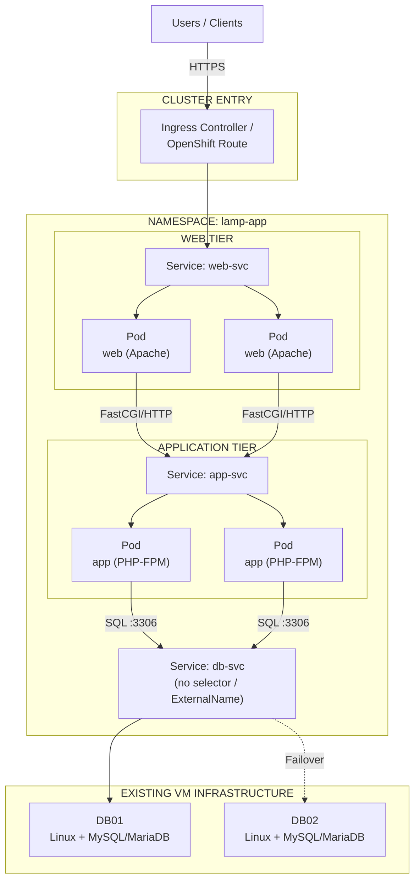
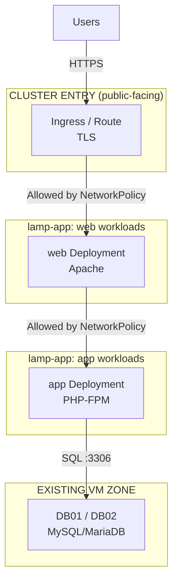

# Detailed Architecture

## 1. Architecture Overview

This architecture re-platforms the Web and Application tiers of the
[On-Premises Three-Tier LAMP Architecture](../three-tier-lamp/architecture.md)
onto Kubernetes/OpenShift, while the Database tier remains on its existing
Linux VMs (DB01/DB02).

The three logical tiers are preserved:

1. **Web Tier** — Apache, running as a Kubernetes Deployment
2. **Application Tier** — PHP-FPM, running as a Kubernetes Deployment
3. **Database Tier** — MySQL/MariaDB, unchanged, external to the cluster

An Ingress Controller (or OpenShift Route) replaces the standalone load
balancer as the cluster-facing entry point. An enterprise L4 load balancer
or DNS may still front the cluster's Ingress/Router nodes; that concern is
infrastructure-level and outside this document.

---

## 2. Logical Architecture



---

## 3. Namespace and Workload Design

| Object                | Kind                                  | Purpose                                           |
| ---------------------- | -------------------------------------- | -------------------------------------------------- |
| `lamp-app`             | Namespace                             | Isolation boundary for this application            |
| `web`                  | Deployment                            | Apache containers serving HTTP(S) and static content |
| `web-svc`              | Service (ClusterIP)                   | Stable internal endpoint for the `web` Deployment   |
| `app`                  | Deployment                            | PHP-FPM containers executing application code      |
| `app-svc`              | Service (ClusterIP)                   | Stable internal endpoint for the `app` Deployment   |
| `db-svc`               | Service (no selector) + Endpoints, or ExternalName | Routes SQL traffic to DB01/DB02 outside the cluster |
| `lamp-ingress`         | Ingress / Route                       | External entry point, TLS termination              |
| `web-config`, `app-config` | ConfigMap                        | Apache and PHP configuration                        |
| `db-credentials`       | Secret                                | Database connection credentials for the App tier    |
| `web-netpol`, `app-netpol`, `db-netpol` | NetworkPolicy        | East-west traffic restriction between tiers         |
| `web-hpa`, `app-hpa`   | HorizontalPodAutoscaler               | Automatic replica scaling under load                |
| `web-pdb`, `app-pdb`   | PodDisruptionBudget                   | Minimum available replicas during voluntary disruption |

---

## 4. Web Tier

### Purpose

Serves as the entry point for HTTP(S) traffic inside the cluster and
handles static content directly.

### Kubernetes Objects

* `web` Deployment — Apache container image, minimum 2 replicas
* `web-svc` — ClusterIP Service, receives traffic from the Ingress/Route
* Readiness and liveness probes against a lightweight `/healthz` endpoint
* Resource `requests`/`limits` set to avoid noisy-neighbor impact

### Responsibilities

* Terminate traffic forwarded from the Ingress Controller/Route
* Serve static content directly from the container image or a mounted volume
* Reverse-proxy dynamic requests to `app-svc`
* Expose a health endpoint for Kubernetes probes and Ingress health checks

### Availability

Replica count is enforced by the Deployment controller. A failed Pod is
automatically restarted or replaced; a `PodDisruptionBudget` protects a
minimum number of available replicas during node drains or upgrades.

---

## 5. Application Tier

### Purpose

Executes the PHP application and business logic, same responsibility as
the VM-based Application Tier.

### Kubernetes Objects

* `app` Deployment — PHP-FPM container image, minimum 2 replicas
* `app-svc` — ClusterIP Service, consumed only by the Web tier
* `db-credentials` Secret mounted as environment variables or a volume
* Readiness/liveness probes verifying the PHP-FPM process and, optionally,
  database connectivity

### Responsibilities

* Execute PHP application code
* Process business logic and validate input
* Read `db-credentials` and connect to `db-svc`
* Return responses to the Web tier

### Availability

Horizontally scaled independently from the Web tier via its own
`HorizontalPodAutoscaler`, preserving the independent-scaling property of
the original three-tier design (see three-tier-lamp ADR-001).

---

## 6. Database Tier

### Purpose

Unchanged from the VM-based architecture: persistent storage, SQL
processing, and transactions on DB01/DB02.

### Cluster Integration

The Database tier is **not** run inside the cluster in this iteration. It
is exposed to in-cluster workloads through one of:

* A `Service` with no selector plus a manually managed `Endpoints` object
  pointing at DB01 (and DB02 on failover), or
* An `ExternalName` Service resolving to the database's existing DNS name

This keeps the Application tier's connection string identical
(`db-svc:3306`) regardless of which VM is currently active, without
requiring the database itself to move.

### Future Enhancement

Running the Database tier inside the cluster (via a `StatefulSet` and
Persistent Volumes, or a database Operator such as the MySQL Operator or
Percona XtraDB Cluster Operator) is deferred — see [Decisions](decisions.md).

---

## 7. Cluster Ingress

The Ingress Controller (Kubernetes) or Router (OpenShift) is the traffic
entry point into the namespace.

### Responsibilities

* Terminate external TLS (or pass through, depending on certificate policy)
* Route external hostnames/paths to `web-svc`
* Apply request-level policies where supported (rate limiting, header rules)

### Kubernetes vs. OpenShift

| Concern            | Kubernetes                          | OpenShift                          |
| -------------------- | ------------------------------------- | ------------------------------------- |
| External entry object | `Ingress` + Ingress Controller (e.g. NGINX) | `Route`                          |
| TLS certificates     | cert-manager, or manually managed Secrets | Route-managed or cert-manager     |
| Pod security          | Pod Security Admission (`restricted`) | Security Context Constraints (SCC) |
| Build pipeline         | External CI builds an image           | Optional S2I `BuildConfig`/`ImageStream` |

This lab targets object types that work on both platforms where possible,
and calls out the platform-specific equivalent where they diverge.

---

## 8. Trust Boundaries



`NetworkPolicy` objects enforce that:

* Only the Ingress Controller can reach `web-svc`
* Only `web` Pods can reach `app-svc`
* Only `app` Pods can reach `db-svc` (and, at the network layer, DB01/DB02)

This is the Kubernetes-native realization of the deny-by-default firewall
posture from three-tier-lamp ADR-008.

---

## 9. Scaling Model

### Web and Application Tiers

Both tiers scale horizontally via `HorizontalPodAutoscaler`, targeting CPU
utilization (and, optionally, custom metrics such as requests-per-second):

```text
web Deployment    : min 2, max 6 replicas, target 70% CPU
app Deployment    : min 2, max 8 replicas, target 70% CPU
```

Because the Web and Application tiers remain separate Deployments, each
scales according to its own load profile — static-heavy traffic spikes
scale `web` without over-scaling `app`, and vice versa.

### Database Tier

Unchanged: scaling and HA remain a VM-level concern, deferred in the same
way as three-tier-lamp ADR-015.

---

## 10. Technology Stack

| Layer                    | Technology                                  |
| ------------------------- | --------------------------------------------- |
| Client                   | Web Browser                                   |
| Cluster Entry             | Ingress Controller / OpenShift Route          |
| Orchestration             | Kubernetes / OpenShift                        |
| Web Container Runtime     | Apache HTTP Server (container image)          |
| Application Container Runtime | PHP-FPM (container image)                 |
| Database                 | MySQL / MariaDB (unchanged, VM-based)         |
| Configuration            | ConfigMap, Secret                             |
| Traffic Policy           | NetworkPolicy                                 |
| Scaling                  | HorizontalPodAutoscaler                       |
| Infrastructure Automation | Ansible (cluster/node provisioning)          |
| Application Delivery     | GitOps (Argo CD) — see Decisions              |
| Documentation            | MkDocs                                        |

---

## 11. Design Constraints

* The cluster (Kubernetes or OpenShift) is assumed to already exist; cluster
  installation and node provisioning are out of scope for this document.
* DB01/DB02 continue to be managed exactly as described in the VM-based lab.
* Container images for `web` and `app` are assumed to be built and published
  by a separate CI pipeline to a trusted registry.
* Namespace-level isolation is assumed sufficient for this iteration; a
  service mesh is not yet introduced.

---

## 12. Future Architecture Enhancements

* Database tier inside the cluster (StatefulSet or Operator)
* GitOps-based promotion across environments (dev/test/prod)
* Service mesh (mTLS between tiers, traffic shaping)
* Progressive delivery (canary or blue/green rollouts)
* Centralized logging and metrics (see a future Observability lab)
* Pod-to-pod mTLS and stricter zero-trust networking
* Multi-cluster or multi-region topology
