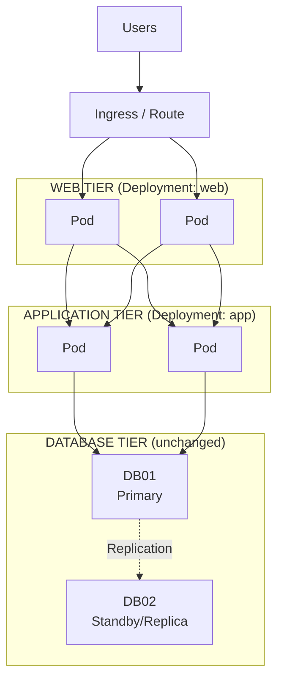

# Availability Architecture

## 1. Availability Overview

Containerization changes *how* availability is achieved for the Web and
Application tiers, but not the availability objectives themselves. The
platform now provides self-healing and automated scaling natively; the
Database tier's availability model is unchanged from the VM-based lab.

High availability is achieved through:

- Multiple replicas per tier, enforced by Deployment controllers
- Automatic Pod restart and rescheduling (kubelet + scheduler)
- Readiness-based traffic removal (no manual load-balancer health-check config)
- `PodDisruptionBudget`s protecting minimum capacity during maintenance
- Unchanged Database tier HA model (DB01/DB02)
- Cluster-level redundancy (multiple nodes, control plane HA)

---

## 2. High-Level Availability Architecture



---

## 3. What Changes vs. the VM-Based Lab

| Concern                    | VM-Based Lab                        | Kubernetes/OpenShift Lab                            |
| ----------------------------- | -------------------------------------- | -------------------------------------------------------- |
| Failure detection            | Load balancer health checks            | kubelet liveness/readiness probes                        |
| Recovery action               | Manual/operational runbook             | Automatic Pod restart/reschedule (Deployment controller) |
| Scaling                       | Manual server provisioning             | `HorizontalPodAutoscaler`                                 |
| Maintenance-window impact     | Manually drained one server at a time  | `PodDisruptionBudget` + rolling update                    |
| New potential failure surface | N/A                                    | Cluster control plane, node pool, etcd                    |

---

## 4. Web and Application Tier Availability

Both tiers are managed by a Deployment with `replicas >= 2` and a
`PodDisruptionBudget` (`minAvailable: 1` at minimum). If a Pod fails:

```text
web Deployment (desired: 2)
    │
    ├── Pod A   ✓
    └── Pod B   X  (liveness probe failed)
                │
                ▼
        kubelet restarts container
                │
                ▼
        ReplicaSet ensures desired replica count is maintained
```

Traffic is never sent to a Pod that has failed its readiness probe — this
replaces the external load-balancer health-check configuration from the
VM-based lab.

---

## 5. Rolling Updates and Rollback

Deployments update via a rolling strategy by default:

```text
Revision N   : 2/2 Pods running old version
Revision N+1 : 1 new Pod started, readiness confirmed, 1 old Pod removed
             : repeat until 2/2 Pods running new version
```

If the new revision fails readiness checks, the rollout can be paused or
rolled back to the previous ReplicaSet without redeploying VMs — a
capability the VM-based lab does not have.

---

## 6. Node and Failure Domain Spread

Multiple replicas provide little protection if they land on the same
node. `web` and `app` Deployments should use `topologySpreadConstraints`
or `podAntiAffinity` to spread replicas across nodes and, where available,
availability zones — the containerized equivalent of the VM-based lab's
"failure domain" guidance.

```text
Node A                      Node B
┌────────────────┐         ┌────────────────┐
│ web Pod (1/2)   │         │ web Pod (2/2)   │
│ app Pod (1/2)   │         │ app Pod (2/2)   │
└────────────────┘         └────────────────┘
```

---

## 7. Database Availability

Unchanged. The Database tier's HA design remains exactly as documented in
the [VM-based availability architecture](../three-tier-lamp/availability.md#8-database-availability),
including the deferred selection of the specific HA technology
(three-tier-lamp ADR-015).

---

## 8. Cluster-Level Availability

New failure surface introduced by adopting Kubernetes/OpenShift:

| Component        | Risk if Single Instance             | Mitigation                                   |
| -------------------- | -------------------------------------- | ----------------------------------------------- |
| Control plane / API server | Cluster-wide management outage   | Multi-node control plane (standard for production clusters) |
| etcd                  | Cluster state loss                     | Multi-member etcd cluster, regular snapshots     |
| Worker nodes            | Reduced capacity, possible Pod eviction | Multiple nodes across failure domains, cluster autoscaling |
| Ingress Controller/Router | Loss of external access             | Multiple Ingress/Router replicas                 |

Cluster installation and control-plane HA are assumed to be handled by
platform/infrastructure teams and are out of scope for this application
architecture — noted here so the dependency is explicit.

---

## 9. Health Checks

### Liveness Probe

Restarts a container that has become unresponsive:

```text
GET /healthz  →  expected 200 OK
```

### Readiness Probe

Removes a Pod from Service endpoints without restarting it — useful when
a Pod is temporarily unable to serve traffic (e.g., warming up, or the
Application tier's database connectivity check fails):

```text
GET /ready  →  expected 200 OK
```

Care should be taken, as in the VM-based lab, not to make readiness
checks expensive (e.g., avoid a full database query on every probe).

---

## 10. Failure Scenarios

| Failure                          | Expected Behavior                                              |
| ------------------------------------ | ------------------------------------------------------------------ |
| Single `web` Pod failure            | kubelet restarts it; traffic served by remaining replicas          |
| Single `app` Pod failure            | Same, independently of the Web tier                                |
| Node failure                        | Pods on that node are rescheduled to healthy nodes                 |
| Ingress Controller/Router Pod failure | Traffic served by remaining Ingress/Router replicas               |
| DB primary failure                  | Unchanged — VM-level failover mechanism from the VM-based lab      |
| Namespace-wide misconfiguration      | Rollback via Deployment revision history or GitOps revert          |
| Cluster control-plane outage         | Running Pods continue serving traffic; no new scheduling/scaling until recovery |

---

## 11. Availability Design Principles

Same principles as the [VM-based lab](../three-tier-lamp/availability.md#21-availability-design-principles),
with the mechanism updated:

1. Avoid single points of failure — now enforced via `replicas >= 2` and `PodDisruptionBudget`
2. Automate failure detection and recovery — now native via kubelet/ReplicaSet rather than a manual runbook
3. Design applications for horizontal scalability — now automated via `HorizontalPodAutoscaler`
4. Protect persistent data separately from application availability — Database tier remains external, unaffected by application-tier changes
5. Spread redundant Pods across failure domains — `topologySpreadConstraints`/`podAntiAffinity`

---

## 12. Future Enhancements

* Multi-zone or multi-cluster deployment
* Automated chaos testing (Pod/node failure injection)
* Cluster autoscaling tuned to `web`/`app` demand
* Bringing the Database tier under cluster-managed HA (Operator-based)
* Automated rollback triggered by SLO burn-rate alerts
