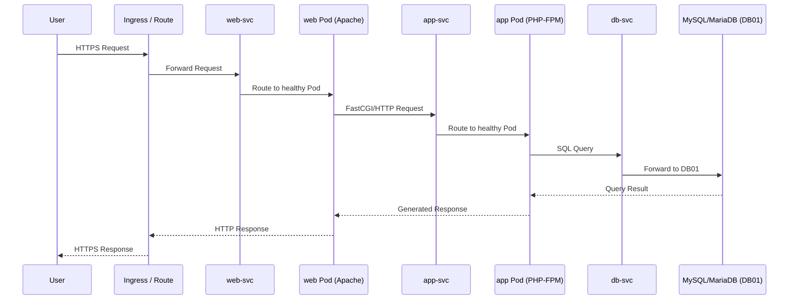
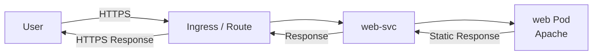
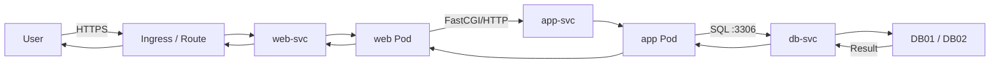
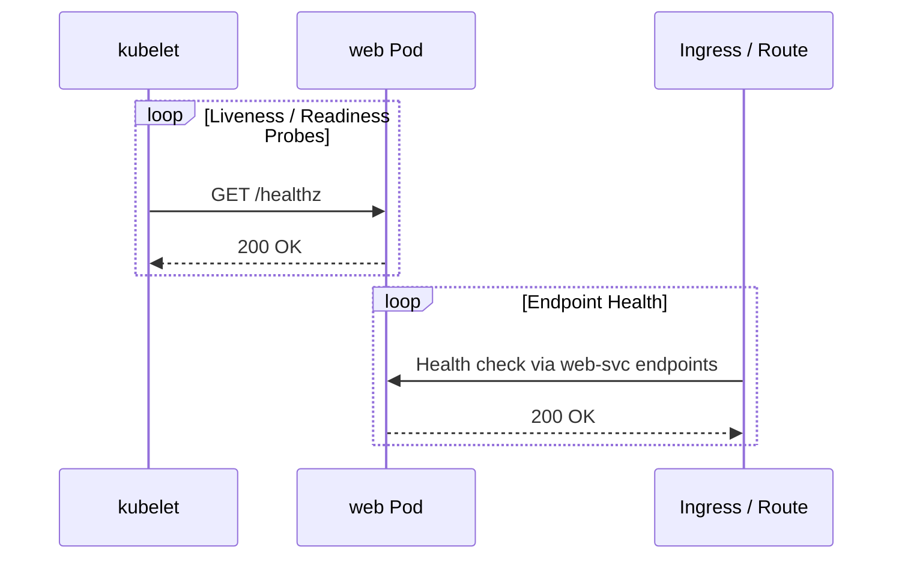

# Data Flow

## 1. Overview

This document describes how application traffic flows through the
containerized three-tier LAMP platform.

The primary request path is:

**User → Ingress/Route → web Service → web Pod → app Service → app Pod → db Service → DB01/DB02**

The response follows the reverse path.

---

## 2. End-to-End Request Flow



---

## 3. Request Processing

### Step 1 — User Request

The user accesses the application over HTTPS, resolving to the cluster's
Ingress Controller (Kubernetes) or Router (OpenShift).

### Step 2 — Ingress / Route

* Terminates or passes through TLS
* Matches the request to the `lamp-app` Ingress/Route rule
* Forwards to `web-svc`

### Step 3 — Web Tier

`web-svc` load-balances across healthy `web` Pods (Apache). Apache:

* Serves static content directly
* Reverse-proxies dynamic requests to `app-svc`

### Step 4 — Application Tier

`app-svc` load-balances across healthy `app` Pods (PHP-FPM), which:

* Read `db-credentials` from the mounted Secret
* Perform authentication, authorization, and business logic
* Query the database via `db-svc`

### Step 5 — Database Tier

`db-svc` resolves to DB01 (or DB02 on failover), which processes the SQL
request exactly as in the VM-based architecture.

---

## 4. Static Content Flow



Static content is served directly from the `web` Pod and does not reach
the Application or Database tiers, same as the VM-based lab.

---

## 5. Dynamic Content Flow



---

## 6. Health Check Flow

Two independent health-check layers exist:



* **kubelet** probes decide whether a Pod is restarted (liveness) or
  removed from a Service's endpoint list (readiness).
* The Ingress/Route relies on the Service's endpoint list, which is itself
  driven by readiness probes — there is no separate load-balancer health
  check to configure, unlike the VM-based lab's external load balancer.

---

## 7. Failure Flow

If a `web` Pod fails:

```text
web Pod (1/2)
     X
     │
     │ Liveness probe fails
     ▼
kubelet restarts the container
     │
     │ Readiness probe fails during restart
     ▼
Removed from web-svc endpoints
     │
     ▼
Traffic continues via the remaining web Pod
```

This differs from the VM-based lab: failure detection and recovery are
handled automatically by the Deployment controller and kubelet, rather
than by an external load balancer's health-check configuration alone.

Database failure handling is unchanged — it remains a VM-level concern,
resolved the same way as in the [three-tier-lamp data flow](../three-tier-lamp/data-flow.md#10-failure-flow).

---

## 8. Communication Matrix

| Source            | Destination        | Protocol     | Port  | Purpose                     |
| ------------------- | --------------------- | ------------ | -----: | ----------------------------- |
| User               | Ingress / Route       | HTTPS        | 443   | Application access            |
| Ingress / Route     | `web-svc`              | HTTP/HTTPS   | 8080  | Cluster-internal web traffic  |
| `web` Pod            | `app-svc`              | FastCGI/HTTP | 9000  | Dynamic request processing    |
| `app` Pod            | `db-svc`               | MySQL        | 3306  | Database access               |
| `db-svc`             | DB01 / DB02            | MySQL        | 3306  | Forward to external database  |
| kubelet             | `web`/`app` Pods       | HTTP         | probe port | Liveness/readiness checks |

---

## 9. Key Design Principles

Carried forward from the [VM-based data flow](../three-tier-lamp/data-flow.md#13-key-design-principles),
with one addition specific to this platform:

### Cluster-Native Health, Not External Health Checks

Failure detection is delegated to the platform (kubelet + Service
endpoints) rather than configured separately on an external load balancer.

### No Direct User-to-Database Access

Unchanged: users never connect directly to `db-svc` or DB01/DB02.

### Least Communication

`NetworkPolicy` objects enforce that each tier can reach only the Service
it depends on — see [Security](security.md).

---

## 10. Future Enhancements

* Custom-metric-based autoscaling (requests-per-second, queue depth)
* Circuit breaking / retries at the mesh layer if a service mesh is introduced
* Distributed tracing across `web` → `app` → database calls
* Structured, centrally shipped logs from both tiers
