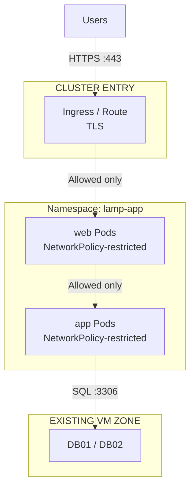

# Security Architecture

## 1. Security Overview

This document maps the security controls established in the
[VM-based Security Architecture](../three-tier-lamp/security.md) onto their
Kubernetes/OpenShift-native equivalents, and adds controls specific to
running containerized workloads.

The security objectives are unchanged: protect application and business
data, minimize attack surface, enforce least privilege, and limit the
blast radius of a compromised component.

---

## 2. Security Architecture



---

## 3. Network Segmentation: VM Zones → Namespaces and NetworkPolicies

| VM-Based Control                  | Kubernetes/OpenShift Equivalent                          |
| ------------------------------------ | ------------------------------------------------------------ |
| DMZ / Web Zone / App Zone / DB Zone | Namespace (`lamp-app`) + `NetworkPolicy` per tier            |
| Firewall rules between zones       | `NetworkPolicy` ingress/egress rules per Pod selector        |
| Management network for SSH          | RBAC-controlled `kubectl`/`oc` access, no direct SSH into Pods |

Default posture: a namespace-wide **deny-all** `NetworkPolicy`, with
explicit allow rules layered on top — the direct realization of
three-tier-lamp ADR-008 ("deny by default").

Example intent (illustrative, not a full manifest):

```text
NetworkPolicy: default-deny-all
  Applies to: all Pods in lamp-app
  Allows: nothing by default

NetworkPolicy: allow-ingress-to-web
  Applies to: Pods labeled tier=web
  Allows from: Ingress Controller namespace, port 8080

NetworkPolicy: allow-web-to-app
  Applies to: Pods labeled tier=app
  Allows from: Pods labeled tier=web, port 9000

NetworkPolicy: allow-app-to-db-egress
  Applies to: Pods labeled tier=app
  Allows to: DB01/DB02 CIDR, port 3306
```

---

## 4. TLS / HTTPS

External traffic uses HTTPS, terminated at the Ingress Controller or
OpenShift Route.

| Concern            | Kubernetes                     | OpenShift                  |
| --------------------- | --------------------------------- | ------------------------------ |
| Certificate issuance | cert-manager                      | Route-managed or cert-manager  |
| Certificate renewal   | Automated via cert-manager        | Automated                      |
| Internal TLS          | Optional — service mesh or manual | Optional — service mesh or manual |

As in the VM-based lab, HTTP should be disabled or redirected to HTTPS,
and internal tier-to-tier encryption can be added later if required.

---

## 5. Pod and Container Security

New controls specific to containerized workloads, not present in the
VM-based lab:

| Control                          | Kubernetes                                  | OpenShift                          |
| ----------------------------------- | ---------------------------------------------- | -------------------------------------- |
| Non-root containers                | `runAsNonRoot: true` in Pod Security Context   | Enforced by default (restricted SCC)   |
| Read-only root filesystem          | `readOnlyRootFilesystem: true`                 | Same, via `restricted` SCC             |
| Dropped Linux capabilities         | `capabilities.drop: ["ALL"]`                   | Same                                   |
| Privilege escalation               | `allowPrivilegeEscalation: false`              | Denied by default (restricted SCC)     |
| Baseline enforcement mechanism      | Pod Security Admission (`restricted` profile)  | Security Context Constraints (SCC)     |

---

## 6. Application Security

Unchanged from the [VM-based lab](../three-tier-lamp/security.md#9-application-security):
input validation, output encoding, SQL injection/XSS/CSRF protection,
secure session handling, and dependency vulnerability management remain
PHP application-level concerns regardless of runtime platform.

Database credentials must never be baked into container images or
committed to Git — see [Secrets Management](#8-secrets-management).

---

## 7. Image and Supply Chain Security

New concerns introduced by containerization:

* **Minimal base images** — prefer slim/distroless images for `web` and `app`
* **Image scanning** — scan images for known CVEs before deployment
  (e.g., Trivy, or the registry's built-in scanning)
* **Trusted registry** — pull only from an approved internal or verified
  registry
* **Image provenance** — sign images and verify signatures at admission
  time where the platform supports it (e.g., `cosign`, OpenShift image
  signature verification)
* **SBOM** — generate a software bill of materials as part of the CI
  pipeline that builds the `web` and `app` images

This extends three-tier-lamp's "Dependency vulnerability management"
control to the image layer, not just PHP dependencies.

---

## 8. Secrets Management

| VM-Based Approach                        | Kubernetes/OpenShift Approach                                  |
| -------------------------------------------- | ------------------------------------------------------------------ |
| Enterprise secrets platform (Vault, etc.)  | Kubernetes `Secret` objects initially; External Secrets Operator or Vault CSI/Injector integration as a future step |
| Never in Git or source code                | Never in Git, ConfigMaps, or container images                      |

Kubernetes `Secret` objects are base64-encoded, not encrypted, by default.
For this iteration:

* Enable encryption at rest for `Secret` objects at the cluster/etcd level
* Restrict `Secret` read access via RBAC to only the `app` ServiceAccount
* Treat native `Secret` objects as an interim solution — integrating an
  external secrets manager (Vault, Azure Key Vault) is tracked as a future
  enhancement, consistent with the VM-based lab's own deferred decision

---

## 9. Identity and Access Management

| VM-Based Control              | Kubernetes/OpenShift Equivalent                          |
| -------------------------------- | ------------------------------------------------------------ |
| Restricted DB account per app  | Dedicated `ServiceAccount` per Deployment, least-privilege RBAC |
| SSH + bastion for admin access | `kubectl`/`oc` access via SSO-backed cluster identity + RBAC   |
| Privileged access controls      | `ClusterRole`/`Role` bindings scoped to the `lamp-app` namespace |

No component should use the default ServiceAccount or a cluster-admin
role. `web` and `app` each get their own minimally scoped ServiceAccount.

---

## 10. Logging and Auditing

| Source              | VM-Based Lab                | Kubernetes/OpenShift Lab                                |
| ---------------------- | ------------------------------ | ------------------------------------------------------------ |
| Web access/error logs | Apache log files on WEB01/02  | Container stdout/stderr from `web` Pods                     |
| Application logs      | PHP log files on APP01/02     | Container stdout/stderr from `app` Pods                     |
| Infrastructure events  | Linux auth/audit logs         | Kubernetes audit logs + node-level logs                      |
| Database logs          | MySQL/MariaDB logs             | Unchanged — collected from DB01/DB02 as before               |

Container logs should be shipped to the same centralized logging platform
referenced in the VM-based lab, rather than read from individual Pods —
this is expanded on in a future Observability lab.

---

## 11. Security Principles

Unchanged from the [VM-based lab](../three-tier-lamp/security.md#20-security-principles):
defense in depth, least privilege, deny by default, network segmentation,
encryption in transit, secure credential management, centralized logging,
continuous monitoring, regular patching, auditable administrative access.

Two additions specific to this platform:

11. **Immutable infrastructure** — containers are replaced, not patched, in place
12. **Verified supply chain** — only scanned, signed images are deployed

---

## 12. Future Security Enhancements

* External Secrets Operator or Vault integration, replacing native `Secret` objects
* Admission control (e.g., OPA/Gatekeeper or Kyverno) to enforce policy at deploy time
* Service mesh mTLS between tiers
* Image signing enforcement at admission
* Runtime threat detection (e.g., Falco)
* SIEM integration for Kubernetes audit logs
