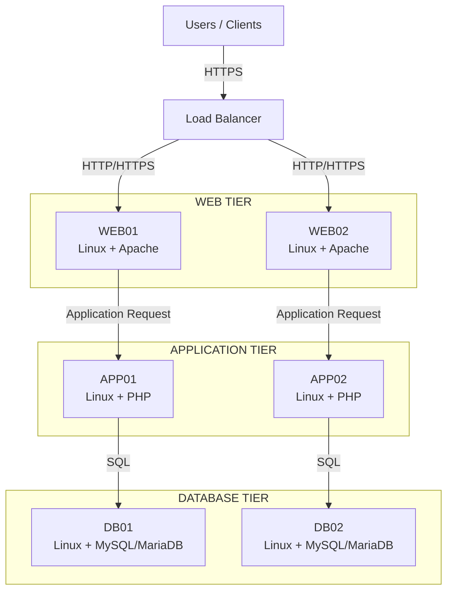
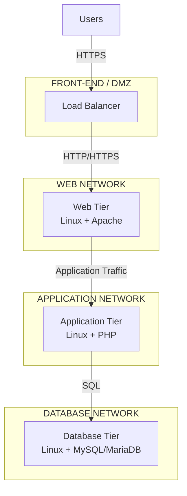

# Detailed Architecture

## 1. Architecture Overview

The solution follows a classic three-tier application architecture deployed on on-premises Linux infrastructure.

The architecture separates:

1. **Web Tier** — Apache
2. **Application Tier** — PHP
3. **Database Tier** — MySQL/MariaDB

A load balancer distributes incoming requests across the Web Tier.

---

## 2. Logical Architecture



---

## 3. Web Tier

### Purpose

The Web Tier acts as the presentation and HTTP processing layer.

### Components

| Component     | Description                   |
| ------------- | ----------------------------- |
| WEB01         | Linux server running Apache   |
| WEB02         | Linux server running Apache   |
| Load Balancer | Distributes incoming requests |

### Responsibilities

* Accept HTTP/HTTPS traffic from the load balancer
* Serve static content
* Handle HTTP processing
* Forward dynamic application requests
* Apply Apache configuration and security controls
* Generate access and error logs

### Availability

At least two Web Tier servers are deployed so that a single server failure does not make the application unavailable.

---

## 4. Application Tier

### Purpose

The Application Tier executes the PHP application and contains business logic.

### Components

| Component | Description              |
| --------- | ------------------------ |
| APP01     | Linux server running PHP |
| APP02     | Linux server running PHP |

### Responsibilities

* Execute PHP application code
* Process business logic
* Validate application input
* Manage application sessions
* Communicate with the database
* Return application responses

### Availability

The Application Tier is horizontally scalable.

Additional application servers can be added when application workload increases.

---

## 5. Database Tier

### Purpose

The Database Tier provides persistent data storage for the application.

### Components

| Component | Description                        |
| --------- | ---------------------------------- |
| DB01      | Linux server running MySQL/MariaDB |
| DB02      | Linux server running MySQL/MariaDB |

### Responsibilities

* Store persistent application data
* Process SQL queries
* Maintain transactions
* Provide database services to the Application Tier
* Support backup and recovery

### Database Availability

The final database high-availability design will determine whether DB01 and DB02 operate as:

* Primary/Standby
* Primary/Replica
* Synchronous replication
* Galera cluster
* Another supported HA architecture

The specific technology will be selected based on application requirements and operational constraints.

---

## 6. Load Balancing

The Load Balancer provides the entry point for application traffic.

### Responsibilities

* Accept client connections
* Distribute traffic across Web Tier servers
* Perform health checks
* Remove unhealthy servers from the traffic pool
* Support session persistence when required
* Provide TLS termination if selected as the TLS endpoint

Possible implementations include:

* HAProxy
* F5 BIG-IP
* Enterprise ADC

The specific implementation is an infrastructure decision and is not fixed by this logical architecture.

---

## 7. Communication Paths

| Source           | Destination      | Protocol            | Purpose                |
| ---------------- | ---------------- | ------------------- | ---------------------- |
| Client           | Load Balancer    | HTTPS / 443         | Application access     |
| Load Balancer    | Web Tier         | HTTP/HTTPS          | Web traffic            |
| Web Tier         | Application Tier | HTTP/FastCGI        | Application processing |
| Application Tier | Database Tier    | MySQL / 3306        | Database access        |
| Monitoring       | Infrastructure   | Monitoring protocol | Monitoring             |
| Servers          | Log Platform     | Syslog/Agent        | Centralized logging    |

The exact application protocol between Apache and PHP will depend on the selected PHP deployment model.

---

## 8. Trust Boundaries

The architecture contains separate trust boundaries between the major tiers.



The Database Tier has the highest protection level because it contains persistent business data.

---

## 9. Scaling Model

### Web Tier

Scale horizontally by adding additional Apache servers:

```text
WEB01
WEB02
WEB03
...
WEB-N
```

### Application Tier

Scale horizontally by adding additional PHP application servers:

```text
APP01
APP02
APP03
...
APP-N
```

### Database Tier

Database scaling requires a separate strategy because databases have state and consistency requirements.

Possible approaches include:

* Read replicas
* Primary/standby
* Database clustering
* Database sharding where appropriate

---

## 10. Architectural Characteristics

| Characteristic           | Design                       |
| ------------------------ | ---------------------------- |
| Deployment               | On-premises                  |
| Operating System         | Linux                        |
| Architecture             | Three-tier                   |
| Web Server               | Apache                       |
| Application Runtime      | PHP                          |
| Database                 | MySQL/MariaDB                |
| Load Balancer            | HAProxy/F5                   |
| Web Scalability          | Horizontal                   |
| Application Scalability  | Horizontal                   |
| Database Scalability     | Separate HA/scaling strategy |
| Network Segmentation     | Yes                          |
| Centralized Logging      | Planned                      |
| Monitoring               | Planned                      |
| Configuration Management | Ansible                      |

---

## 11. Design Constraints

The architecture assumes:

* Linux is the standard server operating system.
* Apache is the selected Web Tier technology.
* PHP is the application runtime.
* MySQL or MariaDB is used for persistent data.
* Infrastructure is hosted on-premises.
* Network segmentation is available.
* A load-balancing capability is available.
* Database HA requirements will be determined separately.

---

## 12. Future Architecture Enhancements

The following areas will be addressed in subsequent design sections:

* Detailed network topology
* VLAN and subnet design
* Firewall rules
* TLS architecture
* Identity and access management
* Server hardening
* Database HA
* Backup architecture
* Disaster recovery
* Monitoring
* Centralized logging
* CI/CD
* Ansible automation
* Infrastructure provisioning