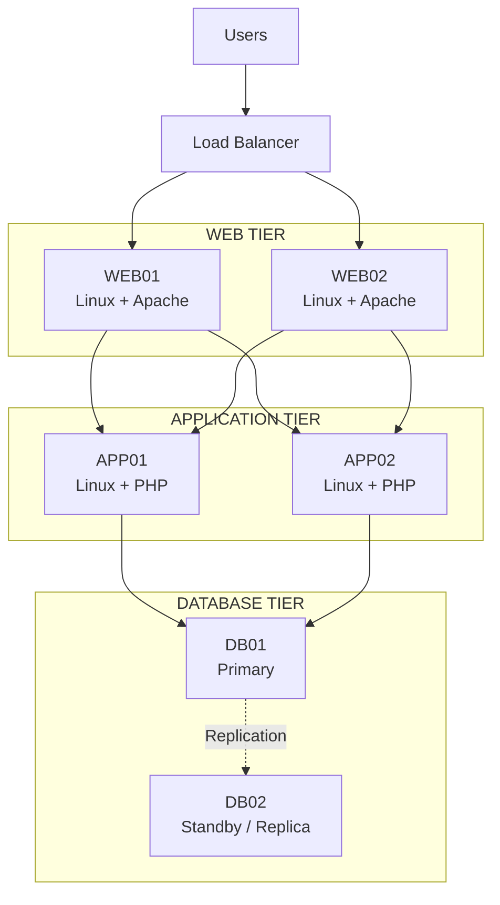
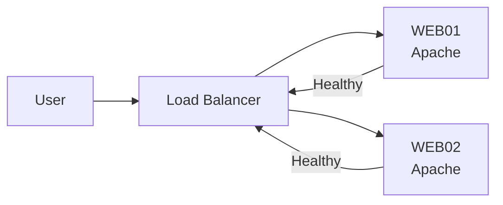
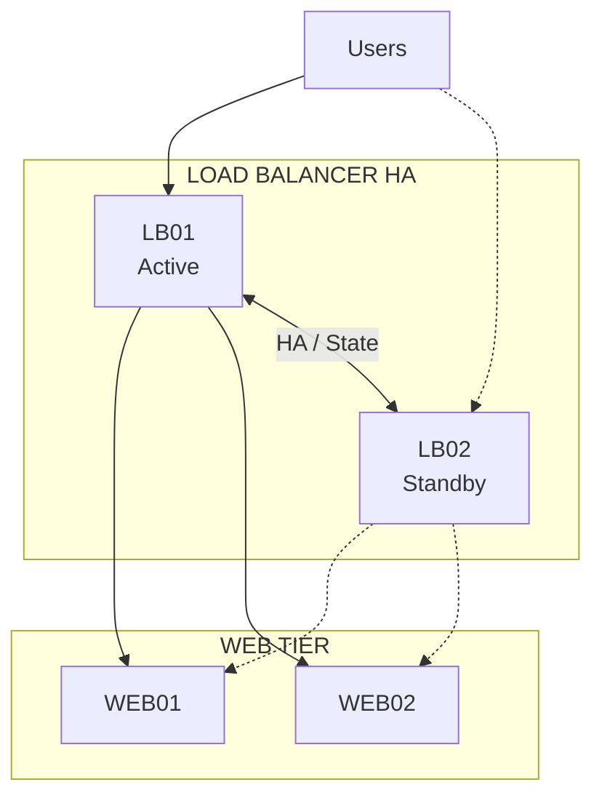

# Availability Architecture

## 1. Availability Overview

The platform is designed to minimize service disruption caused by individual infrastructure or application component failures.

High availability is primarily achieved through:

- Multiple Web Tier servers
- Multiple Application Tier servers
- Load-balancer health checks
- Database high-availability mechanisms
- Redundant infrastructure
- Monitoring and alerting
- Backup and recovery procedures

The final availability design depends on the required business SLA and RTO/RPO.

---

## 2. High-Level Availability Architecture



---

## 3. Availability Objectives

The architecture should be designed according to measurable availability requirements.

| Metric | Description |
|---|---|
| SLA | Target service availability |
| RTO | Maximum acceptable recovery time |
| RPO | Maximum acceptable data loss |
| MTTR | Mean time to restore service |
| MTBF | Mean time between failures |

These values should be agreed with the business before finalizing the HA design.

---

## 4. Web Tier Availability

The Web Tier contains at least two Apache servers:

```text
WEB01
WEB02
```

The Load Balancer distributes traffic between healthy servers.



If WEB01 fails, the Load Balancer removes it from the active pool.

Traffic continues through WEB02.

---

## 5. Web Tier Failure Scenario

Normal operation:

```text
Load Balancer
    |
    +---- WEB01
    |
    +---- WEB02
```

If WEB01 fails:

```text
Load Balancer
    |
    +---- WEB01   X
    |
    +---- WEB02   ✓
```

The Load Balancer should detect the failure using health checks.

New client requests are sent only to healthy servers.

---

## 6. Application Tier Availability

The Application Tier contains multiple PHP application servers:

```text
APP01
APP02
```

The architecture should avoid storing critical session state only on one application server.

Where sessions are required, possible approaches include:

- Shared session storage
- Database-backed sessions
- Distributed cache
- Stateless application design

A stateless application design is preferred where practical.

---

## 7. Application Tier Failure Scenario

Normal operation:

```text
WEB01 ──► APP01
WEB01 ──► APP02

WEB02 ──► APP01
WEB02 ──► APP02
```

If APP01 becomes unavailable:

```text
WEB01 ──► APP02

WEB02 ──► APP02
```

The remaining Application Tier server continues processing requests.

---

## 8. Database Availability

The Database Tier requires a dedicated high-availability strategy because database systems maintain persistent state.

A possible initial model is:

```text
              ┌──────────────┐
              │    APP01     │
              └──────┬───────┘
                     │
              ┌──────▼───────┐
              │    APP02     │
              └──────┬───────┘
                     │
                     ▼
              ┌──────────────┐
              │    DB01      │
              │   PRIMARY    │
              └──────┬───────┘
                     │
                Replication
                     │
                     ▼
              ┌──────────────┐
              │    DB02      │
              │   STANDBY    │
              └──────────────┘
```

The exact database HA technology will be selected based on:

- RPO requirements
- RTO requirements
- Transaction volume
- Data consistency requirements
- Operational skills
- Licensing
- Storage architecture

---

## 9. Database HA Options

Possible MySQL/MariaDB availability models include:

| Model | Description |
|---|---|
| Primary/Replica | Primary database replicates data to one or more replicas |
| Primary/Standby | Standby database can be promoted after primary failure |
| Synchronous Replication | Transactions are replicated synchronously |
| Galera Cluster | Multi-node synchronous database clustering |
| Managed Database | Database HA provided by an external platform |

The final solution should be selected based on business and technical requirements.

---

## 10. Load Balancer Availability

The Load Balancer itself can become a single point of failure if only one instance is deployed.

For production environments, a redundant Load Balancer architecture should be considered.



Possible implementations include:

- F5 BIG-IP HA pair
- HAProxy with Keepalived
- Enterprise ADC HA
- Other supported load-balancing platforms

---

## 11. Infrastructure Redundancy

Application availability also depends on the underlying infrastructure.

Potential single points of failure include:

- Hypervisor
- Physical server
- Network switch
- Storage system
- Power
- Network connection
- Load Balancer
- Database

The architecture should therefore consider infrastructure-level redundancy.

---

## 12. Server Redundancy

A minimum production deployment should avoid relying on a single physical host.

For example:

```text
             Physical / Virtual Infrastructure

      ┌──────────────────┐
      │ Hypervisor / Host│
      │       01         │
      └──────────────────┘
          │          │
       WEB01       APP01


      ┌──────────────────┐
      │ Hypervisor / Host│
      │       02         │
      └──────────────────┘
          │          │
       WEB02       APP02
```

WEB01 and WEB02 should ideally be placed on separate failure domains.

The same principle should be considered for database servers.

---

## 13. Failure Domains

Failure domains should be considered when placing redundant components.

Examples include:

- Physical server
- Rack
- Power domain
- Network switch
- Storage system
- Data center

Avoid placing all redundant components on the same failure domain.

For example:

```text
             Data Center

      Failure Domain A
      ┌───────────────┐
      │ WEB01         │
      │ APP01         │
      │ DB01          │
      └───────────────┘


      Failure Domain B
      ┌───────────────┐
      │ WEB02         │
      │ APP02         │
      │ DB02          │
      └───────────────┘
```

---

## 14. Health Checks

Health checks are required to detect unhealthy components.

### Load Balancer

The Load Balancer should check Web Tier availability.

Example:

```text
GET /health
```

Expected response:

```text
HTTP 200 OK
```

A failed health check should remove the server from the traffic pool.

---

## 15. Application Health Checks

A simple application health check should verify that the application process is responding.

A deeper health check can verify:

- PHP runtime
- Application dependencies
- Database connectivity
- Required configuration
- External dependencies

Care should be taken not to make health checks unnecessarily expensive.

---

## 16. Database Health Checks

Database monitoring should verify:

- Database process status
- Connectivity
- Replication status
- Replication lag
- Disk space
- Connection utilization
- Query performance
- Transaction health

Database failover should be controlled and tested.

---

## 17. Backup and Recovery

High availability does not replace backups.

The platform should implement:

- Database backups
- Configuration backups
- Application backups where required
- Backup retention
- Off-host backup storage
- Backup encryption
- Restore testing

The recovery process should be documented and tested regularly.

---

## 18. Disaster Recovery

High availability protects against component failures.

Disaster Recovery protects against larger failures such as:

- Data center outage
- Major infrastructure failure
- Storage corruption
- Ransomware
- Large-scale network outage

A DR strategy may include:

```text
Primary Data Center
        |
        | Replication / Backup
        |
        v
Secondary Data Center
```

The appropriate DR model depends on business requirements.

---

## 19. Availability Monitoring

Monitoring should detect:

- Server availability
- Application availability
- Load Balancer health
- Database health
- Replication status
- CPU utilization
- Memory utilization
- Disk utilization
- Network errors
- Application errors

Alerts should be integrated with the organization's incident-management process.

---

## 20. Failure Scenarios

| Failure | Expected Behavior |
|---|---|
| WEB01 failure | Traffic moves to WEB02 |
| WEB02 failure | Traffic moves to WEB01 |
| APP01 failure | Requests continue through APP02 |
| APP02 failure | Requests continue through APP01 |
| DB primary failure | Database failover mechanism activates |
| Load Balancer failure | Standby/load-balancer HA node takes over |
| Single physical host failure | Workloads continue on alternate infrastructure where designed |
| Data center failure | DR strategy is invoked |

---

## 21. Availability Design Principles

The architecture follows these principles:

1. Avoid single points of failure.
2. Use redundancy for critical components.
3. Separate redundant systems across failure domains.
4. Perform continuous health monitoring.
5. Automate failure detection where appropriate.
6. Design applications for horizontal scalability.
7. Protect persistent data separately from application availability.
8. Maintain tested backups.
9. Define RTO and RPO.
10. Regularly test failover and recovery procedures.

---

## 22. Future Enhancements

The following areas can be designed in more detail:

- Exact RTO/RPO targets
- F5 or HAProxy HA architecture
- MySQL/MariaDB replication
- Database automatic failover
- Keepalived/VRRP
- Shared storage
- Virtualization HA
- Multi-site architecture
- Disaster Recovery
- Backup architecture
- Automated failover testing
- Chaos/failure testing
- Application session management