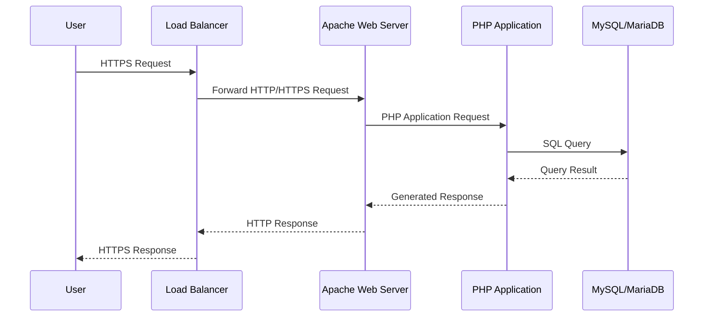
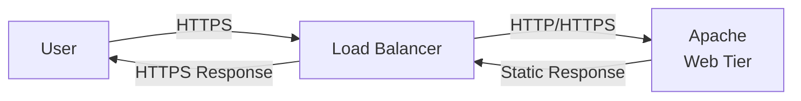
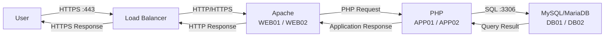
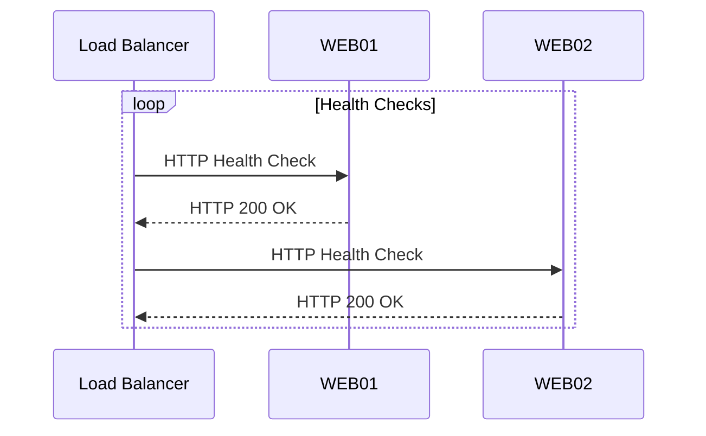

# Data Flow

## 1. Overview

This document describes how application traffic and data flow through the three-tier LAMP architecture.

The primary request path is:

**User → Load Balancer → Web Tier → Application Tier → Database Tier**

The response follows the reverse path back to the user.

---

## 2. End-to-End Request Flow



---

## 3. Request Processing

### Step 1 — User Request

The user accesses the application using a web browser.

Example:

```text
https://application.example.com
```

The request is sent over HTTPS.

---

### Step 2 — Load Balancer

The Load Balancer receives the client request.

It performs:

* Listener processing
* TLS handling where applicable
* Backend health checks
* Load-balancing decision
* Forwarding to a healthy Web Tier server

For example:

```text
WEB01 → Healthy
WEB02 → Healthy
```

The Load Balancer can distribute requests between both servers.

---

### Step 3 — Web Tier

Apache receives the request on WEB01 or WEB02.

The Web Tier determines whether the request is:

* Static content
* Dynamic PHP content
* Invalid or unauthorized traffic

Static content can be returned directly by Apache.

Dynamic PHP requests are passed to the PHP application runtime.

---

### Step 4 — Application Tier

The PHP application receives the dynamic request.

The application performs tasks such as:

* Authentication
* Authorization
* Input validation
* Business logic
* Session processing
* Database queries

If persistent data is required, the application establishes a connection to the database service.

---

### Step 5 — Database Tier

The PHP application sends SQL requests to MySQL/MariaDB.

Example:

```text
APP01 → DB01
```

The database:

1. Receives the SQL request.
2. Validates and executes the query.
3. Reads or modifies data.
4. Commits the transaction where required.
5. Returns the result to the application.

---

## 4. Response Flow

After the application receives the database response:

```text
Database
   ↓
PHP Application
   ↓
Apache
   ↓
Load Balancer
   ↓
User
```

The PHP application generates the required response.

Apache returns the response to the Load Balancer.

The Load Balancer sends the final response to the client.

---

## 5. Static Content Flow

Static content does not necessarily need to reach the Database Tier.



Examples include:

* HTML
* CSS
* JavaScript
* Images
* Fonts

This reduces unnecessary application and database traffic.

---

## 6. Dynamic Content Flow

Dynamic application requests continue through the Application Tier.



---

## 7. Database Read Flow

A typical database read follows this sequence:

```text
User
 ↓
Load Balancer
 ↓
Apache
 ↓
PHP Application
 ↓
SQL SELECT
 ↓
MySQL/MariaDB
 ↓
Result Set
 ↓
PHP Application
 ↓
Apache
 ↓
Load Balancer
 ↓
User
```

---

## 8. Database Write Flow

A database write follows a similar path.

```text
User
 ↓
Load Balancer
 ↓
Apache
 ↓
PHP Application
 ↓
SQL INSERT / UPDATE / DELETE
 ↓
MySQL/MariaDB
 ↓
Transaction Commit
 ↓
PHP Application
 ↓
Apache
 ↓
Load Balancer
 ↓
User
```

Database writes must be handled carefully when a replicated or clustered database architecture is introduced.

---

## 9. Health Check Flow

The Load Balancer periodically checks the health of Web Tier servers.



If a Web Tier server fails its health check, the Load Balancer should stop sending new requests to that server.

---

## 10. Failure Flow

If WEB01 becomes unavailable:

```text
WEB01
  X
  │
  │ Health Check Failed
  ▼
Load Balancer
  │
  ▼
WEB02
```

New requests are directed to WEB02.

The same principle can later be applied to the Application Tier.

Database failover requires a separate database-specific HA mechanism.

---

## 11. Communication Matrix

| Source           | Destination      | Protocol     |              Port | Purpose            |
| ---------------- | ---------------- | ------------ | ----------------: | ------------------ |
| User             | Load Balancer    | HTTPS        |               443 | Application access |
| Load Balancer    | Web Tier         | HTTP/HTTPS   |            80/443 | Web traffic        |
| Web Tier         | Application Tier | HTTP/FastCGI |               TBD | PHP processing     |
| Application Tier | Database Tier    | MySQL        |              3306 | Database access    |
| Load Balancer    | Web Tier         | HTTP/HTTPS   | Health-check port | Health monitoring  |

The exact Web-to-Application protocol depends on the PHP deployment model selected during implementation.

---

## 12. Data Protection Considerations

Sensitive application data should not be exposed unnecessarily between tiers.

The architecture should consider:

* TLS encryption
* Database connection encryption
* Credential protection
* Secrets management
* Database access controls
* Least-privilege database accounts
* Input validation
* Secure session management

These controls will be detailed in the Security Architecture section.

---

## 13. Key Design Principles

### Least Communication

Each tier should communicate only with the services it requires.

### No Direct User-to-Database Access

Users must never connect directly to MySQL/MariaDB.

### Controlled East-West Traffic

Communication between Web, Application and Database tiers should be controlled through network security policies.

### Stateless Application Design

Where practical, the PHP application should remain stateless so that requests can be distributed across multiple Application Tier servers.

### Centralized Observability

Application and infrastructure events should be available through centralized logging and monitoring platforms.

---

## 14. Future Enhancements

The detailed implementation will address:

* TLS termination point
* Session management
* PHP-FPM architecture
* Database connection pooling
* Database replication
* Database failover
* Distributed sessions
* Caching
* Monitoring
* Centralized logging
* Network firewall policies