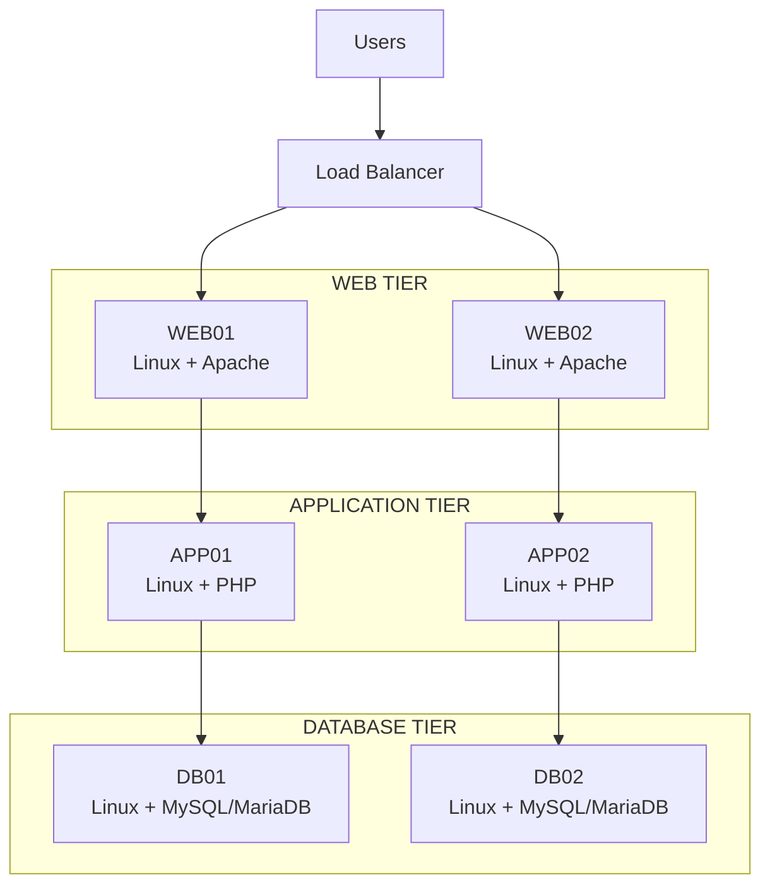

# On-Premises Three-Tier LAMP Architecture

## Executive Summary

This architecture demonstrates a production-oriented three-tier web application platform running on on-premises Linux infrastructure.

The solution separates the application into three logical tiers:

* **Web Tier** — Linux + Apache
* **Application Tier** — Linux + PHP
* **Database Tier** — Linux + MySQL/MariaDB

The architecture is designed to provide scalability, availability, security, and operational maintainability.

---

## Architecture at a Glance



---

## Architecture Layers

### Web Tier

The Web Tier provides the entry point for application traffic.

**Technology**

* Linux
* Apache HTTP Server

**Servers**

* WEB01
* WEB02

**Responsibilities**

* Receive HTTP/HTTPS requests
* Serve static content
* Handle web-server processing
* Forward dynamic application requests
* Apply web-server security controls
* Participate in load-balanced traffic

---

### Application Tier

The Application Tier contains the application business logic.

**Technology**

* Linux
* PHP

**Servers**

* APP01
* APP02

**Responsibilities**

* Execute PHP application code
* Process business logic
* Validate application requests
* Communicate with the database
* Generate dynamic responses

The Application Tier is isolated from direct user access.

---

### Database Tier

The Database Tier provides persistent application data storage.

**Technology**

* Linux
* MySQL or MariaDB

**Servers**

* DB01
* DB02

**Responsibilities**

* Store application data
* Process SQL queries
* Maintain transactions
* Provide database availability
* Support backup and recovery

The Database Tier is not directly accessible from the user network.

---

## Request Flow

A typical application request follows this logical path:

```text
User
  ↓
Load Balancer
  ↓
Web Tier
  ↓
Application Tier
  ↓
Database Tier
  ↓
Application Tier
  ↓
Web Tier
  ↓
Load Balancer
  ↓
User
```

---

## Key Architecture Principles

### Separation of Concerns

Each tier has a clearly defined responsibility.

### Horizontal Scalability

Additional Web or Application servers can be added when application demand increases.

### Network Segmentation

Each tier should be placed in an appropriate network zone with controlled communication between tiers.

### Security

Users should never communicate directly with the Application or Database tiers.

### High Availability

Multiple Web and Application servers reduce the impact of individual server failures.

### Observability

The platform should provide infrastructure monitoring, application monitoring, centralized logging, and alerting.

### Automation

Server configuration and application deployment should be automated using tools such as Ansible and CI/CD pipelines.

---

## Technology Stack

| Layer                    | Technology         |
| ------------------------ | ------------------ |
| Client                   | Web Browser        |
| Load Balancer            | HAProxy / F5       |
| Operating System         | Linux              |
| Web Server               | Apache HTTP Server |
| Application              | PHP                |
| Database                 | MySQL / MariaDB    |
| Configuration Management | Ansible            |
| Source Control           | Git / GitHub       |
| Documentation            | MkDocs             |

---

## Architecture Scope

This initial architecture focuses on the core three-tier application platform.

The following concerns will be designed separately:

* Network architecture
* Security controls
* Firewall rules
* Load-balancing strategy
* Database high availability
* Monitoring and logging
* Backup and recovery
* Disaster recovery
* Deployment automation
* Infrastructure automation

These concerns are documented in the subsequent architecture sections.