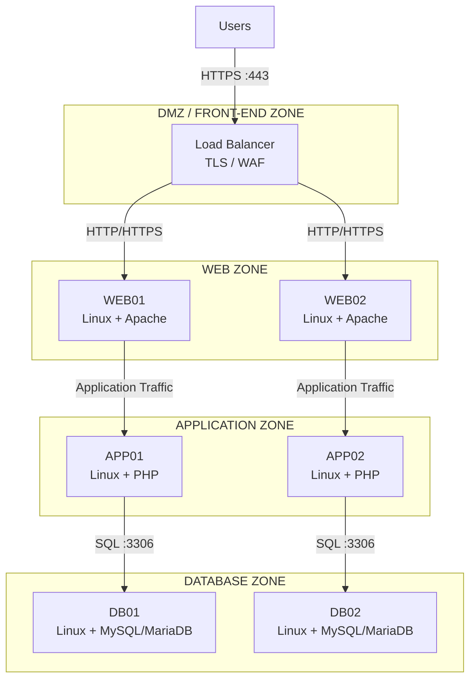
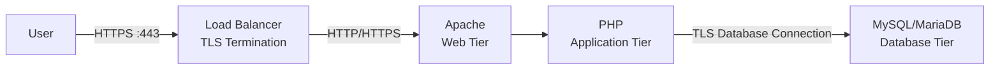

# Security Architecture

## 1. Security Overview

Security is implemented as a layered control model across the three application tiers.

The primary security objectives are:

- Protect application and business data
- Prevent unauthorized access
- Minimize attack surface
- Enforce least privilege
- Encrypt sensitive communications
- Provide security monitoring and auditing
- Limit the impact of a compromised server

---

## 2. Security Architecture



---

## 3. Network Segmentation

Each application tier should reside in a separate network segment.

| Zone | Purpose |
|---|---|
| DMZ | Load Balancer / external entry point |
| Web Zone | Apache servers |
| Application Zone | PHP application servers |
| Database Zone | MySQL/MariaDB servers |
| Management Zone | Administration and infrastructure management |

Traffic between zones should be explicitly controlled by firewalls.

---

## 4. Firewall Policy

The default security posture should be:

> Deny by default and allow only required communication.

Example logical firewall policy:

| Source | Destination | Port | Action | Purpose |
|---|---|---:|---|---|
| Internet/User Network | Load Balancer | 443 | Allow | HTTPS access |
| Load Balancer | Web Tier | 80/443 | Allow | Web traffic |
| Web Tier | Application Tier | Application port | Allow | Application processing |
| Application Tier | Database Tier | 3306 | Allow | Database access |
| Management Network | Servers | 22 | Allow | SSH administration |
| Web Tier | Database Tier | 3306 | Deny | Prevent direct DB access |
| User Network | Database Tier | 3306 | Deny | Prevent direct DB access |
| Internet | Application Tier | Any | Deny | Prevent direct access |
| Internet | Database Tier | Any | Deny | Prevent direct access |

The exact ports will be finalized during the detailed network design.

---

## 5. TLS / HTTPS

External application traffic should use HTTPS.

```text
User
  |
  | HTTPS :443
  v
Load Balancer
```

TLS certificates should be managed through an appropriate certificate lifecycle process.

Considerations include:

- Certificate issuance
- Certificate renewal
- Certificate rotation
- TLS protocol versions
- Strong cipher suites
- Private-key protection

HTTP should either be disabled externally or redirected to HTTPS where appropriate.

---

## 6. TLS Termination

TLS termination can occur at the Load Balancer.



For sensitive environments, encryption can also be maintained between internal tiers.

The final design should consider security requirements, certificate management complexity, and operational overhead.

---

## 7. Operating System Security

All Linux servers should follow an approved server-hardening baseline.

Recommended controls include:

- Minimal package installation
- Regular security patching
- Host-based firewall
- Secure SSH configuration
- Disable unnecessary services
- Disable unnecessary ports
- File-system permissions
- Strong authentication
- Privileged access controls
- Time synchronization
- Security auditing

---

## 8. SSH Administration

Administrative SSH access should not be exposed directly to the public Internet.

Preferred model:

```text
Administrator
      |
      v
Management Network / Bastion
      |
      v
Linux Servers
```

SSH access should use:

- SSH keys
- Centralized identity where available
- Privileged access controls
- MFA through the enterprise access mechanism
- Restricted source networks

Root login over SSH should normally be disabled.

---

## 9. Application Security

The PHP application should implement secure application development practices.

Important controls include:

- Input validation
- Output encoding
- Protection against SQL injection
- Protection against XSS
- CSRF protection
- Secure session handling
- Authentication
- Authorization
- Secure password storage
- Secure error handling
- Dependency vulnerability management

Database credentials must never be hard-coded into source code.

---

## 10. Database Security

The database should accept connections only from authorized Application Tier servers.

Example:

```text
APP01 ───────► DB01
APP02 ───────► DB01

WEB01 ───────X DB01
WEB02 ───────X DB01
```

Database security controls should include:

- Least-privilege database accounts
- Strong authentication
- Restricted network access
- Encrypted database connections where required
- Database auditing
- Secure backups
- Encryption at rest where required
- Regular patching

The application database account should have only the permissions required by the application.

---

## 11. Secrets Management

Sensitive credentials should not be stored directly in:

- Git repositories
- Source code
- Markdown documentation
- Shell scripts
- Configuration files committed to Git

Examples of secrets include:

- Database passwords
- API keys
- TLS private keys
- Service credentials
- SSH private keys

A centralized secrets-management solution should be considered.

Possible enterprise solutions include:

- HashiCorp Vault
- Azure Key Vault
- CyberArk
- Enterprise secrets-management platforms

---

## 12. Identity and Access Management

Access should follow the principle of least privilege.

Administrative roles should be separated from application roles.

Example:

```text
Application User
      |
      v
Application
      |
      v
Restricted DB Account


System Administrator
      |
      v
Management Network
      |
      v
Linux Server
```

Users should receive only the permissions required for their responsibilities.

---

## 13. Web Server Security

Apache should be hardened according to organizational standards.

Recommended controls include:

- Disable unnecessary modules
- Hide unnecessary server information
- Restrict directory access
- Disable directory listing
- Secure configuration files
- Protect sensitive files
- Enable appropriate security headers
- Apply request-size limits
- Restrict HTTP methods where appropriate
- Maintain current security patches

---

## 14. Security Headers

The application should consider security headers such as:

- `Strict-Transport-Security`
- `Content-Security-Policy`
- `X-Content-Type-Options`
- `X-Frame-Options`
- `Referrer-Policy`

The exact header configuration should be validated against application requirements.

---

## 15. Vulnerability and Malware Protection

Servers should be integrated with the organization's security tooling where available.

Possible controls include:

- Endpoint protection
- Vulnerability scanning
- File-integrity monitoring
- Configuration compliance
- Security information and event management
- Application dependency scanning

---

## 16. Logging and Auditing

Security-relevant events should be centrally collected.

### Linux

Examples include:

- Authentication events
- SSH access
- Privilege escalation
- System changes

### Apache

Examples include:

- Access logs
- Error logs
- Suspicious requests

### PHP Application

Examples include:

- Authentication failures
- Authorization failures
- Application errors
- Security events

### Database

Examples include:

- Authentication
- Administrative operations
- Configuration changes
- Sensitive database activity

---

## 17. Monitoring and Alerting

Security and operational monitoring should detect events such as:

- Repeated authentication failures
- Unexpected privileged access
- Server resource anomalies
- Application errors
- Database failures
- Configuration changes
- Suspicious network traffic
- Certificate expiry

Alerts should be integrated with enterprise monitoring and incident-management processes.

---

## 18. Backup Security

Backups should be protected from unauthorized access.

Controls should include:

- Encryption
- Access control
- Backup retention
- Offline or immutable copies where appropriate
- Regular restore testing
- Separation of backup administration from normal application administration

A backup is only considered reliable when restoration has been successfully tested.

---

## 19. Security Zones

The intended security model is:

```text
                  INTERNET
                     |
                     | HTTPS :443
                     v
              +----------------+
              | Load Balancer  |
              | TLS / WAF      |
              +-------+--------+
                      |
                      | Controlled
                      v
              +----------------+
              |    WEB ZONE    |
              | Linux + Apache |
              +-------+--------+
                      |
                      | Controlled
                      v
              +----------------+
              | APPLICATION    |
              |     ZONE       |
              |  Linux + PHP   |
              +-------+--------+
                      |
                      | SQL :3306
                      v
              +----------------+
              | DATABASE ZONE  |
              | Linux + MySQL  |
              |    / MariaDB   |
              +----------------+
```

---

## 20. Security Principles

The architecture follows these core principles:

1. **Defense in depth**
2. **Least privilege**
3. **Deny by default**
4. **Network segmentation**
5. **Encryption in transit**
6. **Secure credential management**
7. **Centralized logging**
8. **Continuous monitoring**
9. **Regular patching**
10. **Auditable administrative access**

---

## 21. Future Security Enhancements

The following areas can be added as the architecture evolves:

- Web Application Firewall
- Enterprise IAM integration
- MFA
- Privileged Access Management
- Centralized secrets management
- SIEM integration
- Vulnerability management
- Database activity monitoring
- File-integrity monitoring
- Zero Trust controls
- Automated security compliance
- DevSecOps pipeline integration