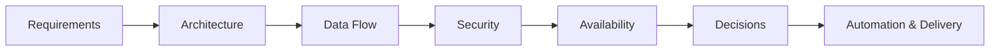

# Solution Architecture Lab

Cloud architecture, platform engineering, and system design — documented
as deliberate architecture practice: designing solutions, documenting
constraints, evaluating trade-offs, and recording the reasoning behind
architectural decisions.

The goal is simple: **not just to draw architectures, but to understand why
they work, how they scale, how they fail, how they are secured, and how
they can be operated effectively.**

---

## Focus Areas

### Solution Architecture

Architecture design, Architecture Decision Records, trade-off analysis,
security, availability, scalability, integration, and end-to-end solution
design — currently covering on-premises three-tier deployments through
containerized Kubernetes/OpenShift platforms.

### System Design

A structured system design curriculum: requirements and estimation,
scalability, availability, distributed systems, data, caching, messaging,
resilience, design patterns, and complete worked case studies.

---

## How This Lab Works

Every architecture follows the same engineering discipline:



The objective is to make architectural thinking explicit:

- What problem are we solving?
- What constraints exist?
- What alternatives were considered?
- Why was a particular approach selected?
- What are the trade-offs?
- How will the solution be secured?
- How will it scale and remain available?
- How will it be operated and automated?

---

## Engineering as Code

This lab is built and maintained using the same principles applied to
software and infrastructure engineering:

```text
VS Code
   ↓
Markdown + Mermaid
   ↓
Git
   ↓
GitHub
   ↓
GitHub Actions
   ↓
MkDocs
   ↓
GitHub Pages
```

Every architecture, diagram, decision, and implementation is version
controlled.

---

## Related

* [chanduazad001.github.io](https://chanduazad001.github.io/) — all labs, and more about me
* [Cybersecurity Architecture Lab](https://chanduazad001.github.io/cybersecurity-architecture-lab/) — application, cloud, and enterprise security architecture
* [AI Platform Architecture Lab](https://chanduazad001.github.io/ai-platform-architecture-lab/) — AI platform architecture and AI system design

---

*Solution Architecture Lab — Chandra Sekhar Merugu*
