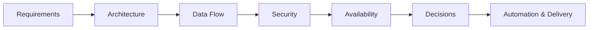

# Chandra Sekhar Merugu

**Solution Architecture, Platform Engineering & Technical Leadership**  
*Infrastructure • Cloud • DevOps • Security • GenAI*

**TOGAF® Certified · DevSecOps & Container Security · 15+ years in Enterprise Infrastructure**

[LinkedIn](https://www.linkedin.com/in/chandrasekhar-merugu){ .md-button .md-button--primary }

---

## About

I'm a Lead Consultant with 15+ years of experience building, securing, and
operating enterprise infrastructure across Linux, Kubernetes, cloud,
observability, and DevSecOps.

My experience spans **solution architecture, platform engineering, technical
leadership, infrastructure automation, security, and vulnerability
management** — with a focus on designing reliable, scalable, and secure
enterprise platforms.

This Solution Architecture Lab is where I turn that experience into deliberate
architecture practice: designing solutions, documenting constraints,
evaluating trade-offs, and recording the reasoning behind architectural
decisions.

The goal is simple: **not just to draw architectures, but to understand why
they work, how they scale, how they fail, how they are secured, and how they
can be operated effectively.**

---

## Focus Areas

### Solution Architecture

Architecture design, Architecture Decision Records, trade-off analysis,
security, availability, scalability, integration, and end-to-end solution
design.

### Platform Engineering

Kubernetes, Linux, OpenShift, Ansible, private cloud, infrastructure
automation, developer platforms, and self-service infrastructure.

### DevSecOps & Security

Secure CI/CD, container security, IAM/RBAC, secrets management,
vulnerability management, and security integrated into the engineering
lifecycle.

### Cloud & Infrastructure

Enterprise infrastructure, cloud architecture, Azure, AWS, virtualization,
observability, and infrastructure automation.

### GenAI & AI Infrastructure

AI applications, RAG architectures, AI agents, observability for AI
workloads, and secure AI infrastructure.

---

## How This Lab Works

Every architecture follows the same engineering discipline:



The objective is to make architectural thinking explicit:

- What problem are we solving?
- What constraints exist?
- What alternatives were considered?
- Why was a particular approach selected?
- What are the trade-offs?
- How will the solution be secured?
- How will it scale and remain available?
- How will it be operated and automated?

---

## Engineering as Code

This lab is built and maintained using the same principles applied to
software and infrastructure engineering:

```text
VS Code
   ↓
Markdown + Mermaid
   ↓
Git
   ↓
GitHub
   ↓
GitHub Actions
   ↓
MkDocs
   ↓
GitHub Pages
```

Every architecture, diagram, decision, and implementation is version
controlled.

---

## Current Work

The lab is evolving across several areas:

- Solution Architecture
- Cloud Architecture
- Platform Engineering
- DevSecOps
- Kubernetes & OpenShift
- Infrastructure Automation
- Python Applications
- GenAI & AI Infrastructure
- Observability & SRE
- Architecture Decision Records

New architectures and engineering experiments will be added as they are
designed and implemented.

---

## Certifications

**Architecture**

TOGAF® Certified (Level 1 & 2)

**Security & DevSecOps**

CEH Master · CEH Practical · CompTIA Security+ · CompTIA CySA+ ·
DevSecOps & Container Security

**Cloud & Infrastructure**

RHCSA · AWS Cloud Practitioner · Microsoft Azure Fundamentals ·
NVIDIA AI Infrastructure & Operations

**Agile**

PSM I

---

## Connect

Open to conversations around:

**Solution Architecture · Platform Engineering · Technical Leadership ·
DevSecOps · Cloud · AI Infrastructure**

[Connect on LinkedIn](https://www.linkedin.com/in/chandrasekhar-merugu){ .md-button .md-button--primary }

---

## Related

* [chanduazad001.github.io](https://chanduazad001.github.io/) — all labs
* [Cybersecurity Architecture Lab](https://chanduazad001.github.io/cybersecurity-architecture-lab/) — application, cloud, and enterprise security architecture

---

> **Architecture is not just about drawing systems.  
> It is about making intentional decisions, understanding trade-offs,
> and building systems that can evolve.**

---

*Solution Architecture Lab — Chandra Sekhar Merugu*