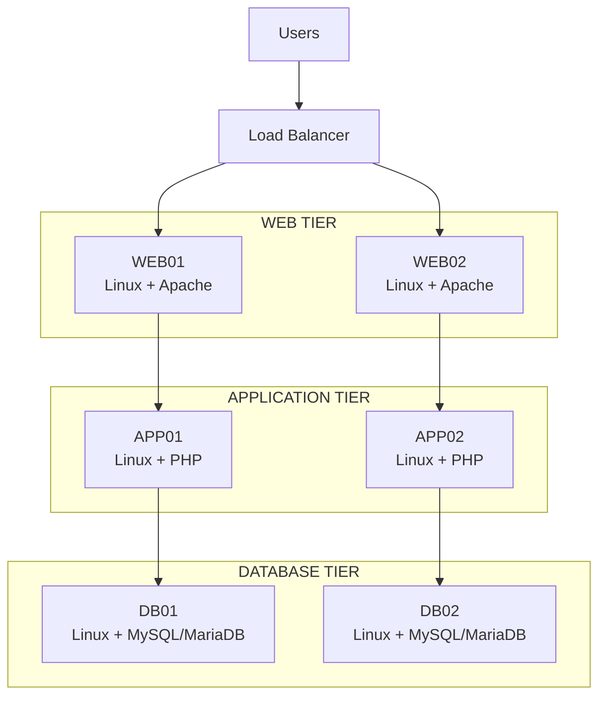

# Architecture Lab

## Cloud Architecture • Platform Engineering • DevSecOps • AI

Welcome to my architecture engineering laboratory.

This repository contains architecture designs, infrastructure patterns,
AI applications, automation experiments, Python applications, and
platform engineering projects.

---

## Featured Architecture

### On-Premises Three-Tier LAMP Platform

A highly available enterprise web application architecture built on
on-premises Linux infrastructure.

The platform follows a classic three-tier architecture:

- **Web Tier** — Linux + Apache
- **Application Tier** — Linux + PHP
- **Database Tier** — Linux + MySQL/MariaDB

---

## Architecture at a Glance

