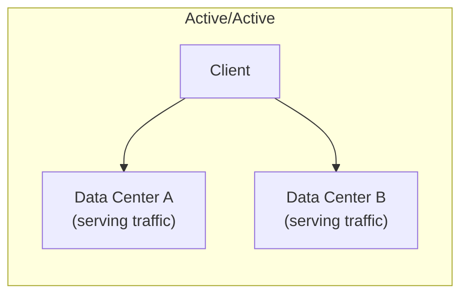
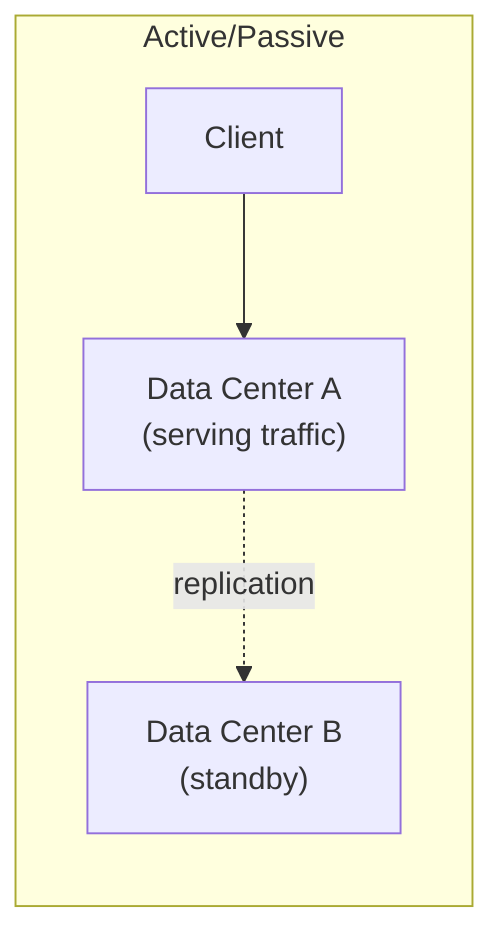
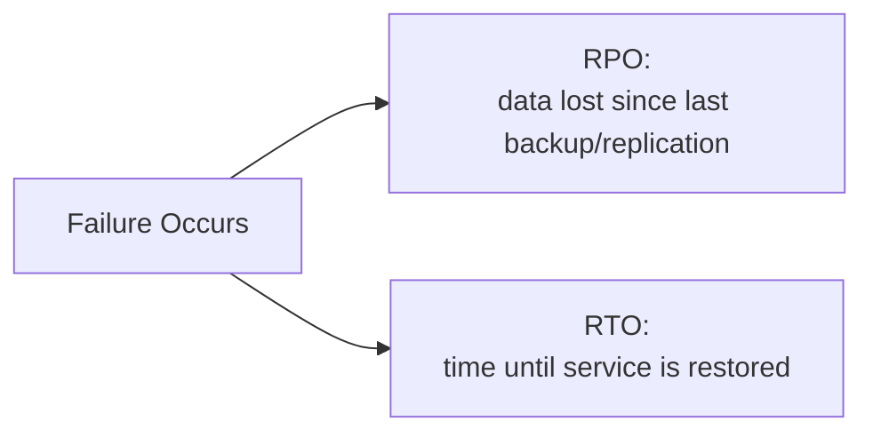

# Availability & Reliability

## 1. What Are Availability & Reliability?

As introduced in [Fundamentals §4](../fundamentals/index.md#4-core-quality-attributes),
**availability** is the proportion of time a system is operational and
responsive; **reliability** is whether it performs its intended function
*correctly* while it's up. A system can be available and unreliable
(returning wrong answers fast) or reliable and unavailable (correct, but
down). This page covers the techniques used to maximize both.

## 2. Why They Exist

Any single component — a server, a disk, a network link, a data center —
will eventually fail. Availability and reliability engineering isn't about
preventing failure (impossible at scale); it's about ensuring no single
failure takes the whole system down, and that failures are detected and
recovered from before they cause lasting damage.

## 3. Availability Math: The Nines

Availability is usually expressed as a percentage of time operational,
and each additional "nine" cuts allowed downtime by roughly 10x:

| Availability | Downtime / Year | Downtime / Month |
| ------------- | ------------------ | ------------------- |
| 99% | 3.65 days | 7.3 hours |
| 99.9% | 8.76 hours | 43.8 minutes |
| 99.95% | 4.38 hours | 21.9 minutes |
| 99.99% | 52.6 minutes | 4.4 minutes |
| 99.999% | 5.3 minutes | 26 seconds |

!!! note "Interview Angle"
    Being asked to design for "five nines" without qualification is a
    prompt to push back: 5.3 minutes of downtime *per year* rules out
    almost any manual intervention during an incident — it implies
    automated failover, not a page to an on-call engineer.

## 4. Redundancy & Failure Domains

Redundancy means no single instance of a component is a single point of
failure. A **failure domain** is the blast radius of one failure — a rack,
a server, a network switch, an entire data center. Good availability
design deliberately spreads redundant components across failure domains,
not just across instances that happen to share the same domain.

!!! danger "Common Trap"
    Running two database replicas for redundancy, both in the same rack
    on the same power circuit. The redundancy is real on paper but shares
    a failure domain — one power event takes out both.

## 5. Active/Active vs Active/Passive

| | Active/Active | Active/Passive |
| --- | --- | --- |
| Capacity utilization | Both sites serve traffic | Standby site is idle until failover |
| Failover time | Near-zero — traffic just shifts | Requires detecting failure and promoting standby |
| Complexity | Higher — must handle multi-site writes/consistency | Lower — one clear source of truth at a time |
| Cost | Standby capacity is productive | Standby capacity is a cost paid for readiness |

## 6. Failover, Health Checks & Heartbeats

Failover only works if failure is detected quickly and correctly:

* **Health checks** — a component is periodically probed (e.g. an HTTP
  endpoint) and removed from rotation if it fails
* **Heartbeats** — a component periodically announces "I'm alive"; absence
  of a heartbeat within a timeout is treated as failure

Both face the same fundamental problem covered in
[Distributed Systems](../distributed-systems/index.md): a missed heartbeat
means either the component failed, or the network between you and it did
— and from the observer's side, those look identical. The same health
signal that drives automated failover here is also what
[Observability §6](../observability/index.md#6-alerting-health-checks)
uses to alert a human.

## 7. Replication for Availability

Replication (also used for read scaling in
[Scalability §5](../scalability/index.md#5-scaling-the-database-read-replicas))
serves a distinct purpose here: if the primary fails, a replica can be
promoted so the system keeps functioning. The trade-off is the same —
asynchronous replication risks losing the most recent writes on failover;
synchronous replication avoids that at the cost of write latency.

## 8. Availability Zones & Regions

* An **Availability Zone (AZ)** is one or more data centers with
  independent power, cooling, and networking — a failure domain boundary.
* A **Region** is a geographic grouping of AZs.

Deploying across multiple AZs protects against a data-center-level
failure; deploying across regions additionally protects against a
regional event, at the cost of higher replication latency and complexity.

## 9. Disaster Recovery: RTO & RPO

Two numbers define a disaster recovery plan:

* **RTO (Recovery Time Objective)** — how long can the system be down
  before recovery must be complete?
* **RPO (Recovery Point Objective)** — how much data can be lost, measured
  as time since the last recoverable state?

An RPO of zero requires synchronous replication everywhere data is
written — a real cost, and rarely justified outside financial or
safety-critical systems.

## 10. Backup & Restore

Backups are the last line of defense — not a substitute for replication
or failover, since a backup restore is typically far slower (a large RTO)
and only as current as the last backup (a non-zero RPO). Untested backups
are a common source of false confidence: a restore procedure that has
never been exercised is unverified.

## 11. Graceful Degradation

When part of the system fails or is overloaded, graceful degradation
means serving a reduced but still useful experience rather than failing
completely — e.g. showing cached recommendations if the personalization
service is down, instead of failing the entire page load.

!!! warning "Production Reality"
    Graceful degradation has to be designed in deliberately per-feature —
    it doesn't happen automatically just because a service is "resilient."
    Which features are essential vs degradable is a product decision, not
    just an engineering one.

## 12. Common Mistakes

* Quoting an availability target with no corresponding RTO/RPO, leaving
  the actual failure-handling requirement undefined
* Redundant instances that share a failure domain
* Treating backups as equivalent to a DR/failover plan
* No graceful-degradation plan, so a single dependency failure takes down
  the whole page/feature rather than just one part of it

## 13. Related Concepts

* [Fundamentals](../fundamentals/index.md) — the definitions of
  availability, reliability, and fault tolerance this page builds on
* [Scalability](../scalability/index.md) — replication and redundancy serve
  both scaling and availability, for different reasons
* [Distributed Systems](../distributed-systems/index.md) — why detecting
  failure across a network is fundamentally ambiguous
