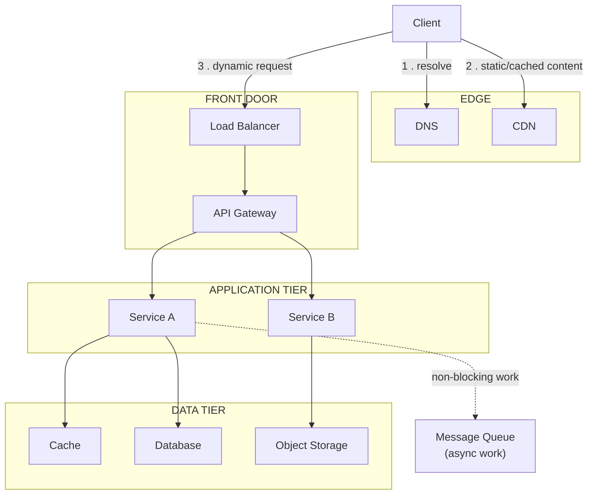

# Core Building Blocks

## 1. What Are Core Building Blocks?

A small set of components recur across almost every non-trivial system,
regardless of domain — the same shapes appear whether you're building a
social feed, a payment platform, or an IoT ingestion pipeline. This page
covers those recurring components: what problem each one solves, how it
fits into a request path, its typical failure mode, and its trade-offs.

## 2. Why They Exist

Each building block below exists because a naive design — a client talking
directly to a single application server talking directly to a single
database — breaks in a specific, predictable way once real traffic,
real failure rates, or real geography get involved. The building blocks
are the standard answers to those specific breakages, not defaults to
apply everywhere.

## 3. Request Path Overview

A typical web request touches several of these components in sequence,
with the message queue sitting off the synchronous path for work that
doesn't need to block the response:

!!! tip "Quick Mental Model"
    Read this diagram left to right as "how fast can we answer without
    hitting the database" — DNS and CDN answer without touching your
    system at all; the cache answers without touching the database; only
    what's left actually reaches the database.

## 4. Building Block Reference

| Component | Problem It Solves | Typical Failure Mode |
| --------- | ------------------- | ---------------------- |
| DNS | Translate a human-readable name to a routable address | Stale records after failover (TTL too high) |
| CDN | Serve static/cacheable content close to the user | Cache poisoning; serving stale content past intended TTL |
| Load Balancer | Spread traffic across multiple instances | Becomes a single point of failure if not itself redundant |
| Reverse Proxy | Terminate connections, offload TLS, shield internal topology | Misconfigured routing exposes internal services |
| API Gateway | Single entry point for auth, rate limiting, routing across services | Becomes a bottleneck or single point of failure if not scaled |
| Application / Web Servers | Execute business logic, render responses | Memory leaks, thread exhaustion under load |
| Databases | Durable, queryable storage | Becomes the bottleneck everything else was built to protect |
| Cache | Serve hot data without hitting the database | Stale data if invalidation is wrong; stampede on mass expiry |
| Object Storage | Store large unstructured blobs (images, files, backups) cheaply | Not designed for low-latency small reads/writes |
| Message Queues / Event Streaming | Decouple producers from consumers, absorb bursts | Unbounded queue growth if consumers fall behind |
| Search Engines | Full-text and faceted search the primary database can't do efficiently | Index falls out of sync with the source of truth |
| Configuration / Service Discovery | Let services find each other and their config without hardcoding | Becomes a dependency every service needs at startup |

## 5. DNS

**Problem:** clients need a stable, memorable name, but the servers behind
it change (failover, scaling, migrations).
**How it fits:** the first hop of nearly every request; resolved once and
cached by the client/OS for the record's TTL.
**Trade-off:** a low TTL makes failover fast but increases DNS query
volume; a high TTL reduces load but slows failover — clients may keep
sending traffic to a dead endpoint until the TTL expires.

## 6. CDN

**Problem:** serving every request from origin means every user pays the
network latency to wherever your servers are, and origin has to handle
every request even for content that never changes.
**How it fits:** sits in front of the origin, caching static and
semi-static content (images, JS/CSS, video, sometimes API responses) at
edge locations near users.
**Trade-off:** dramatically reduces origin load and latency for cacheable
content, at the cost of a cache-invalidation problem — see
[Common Mistakes](#16-common-mistakes-across-building-blocks) and the future
Caching topic.

## 7. Load Balancer

**Problem:** a single application server has a capacity ceiling and is a
single point of failure.
**How it fits:** distributes incoming requests across multiple stateless
instances (see [Fundamentals §7](../fundamentals/index.md#7-stateless-vs-stateful-systems)),
using a policy such as round robin, least connections, or latency-based
routing.
**Trade-off:** enables horizontal scaling and removes the single point of
failure at the app tier, but the load balancer itself must now be made
highly available (often via DNS round robin to multiple LB instances, or a
managed/anycast LB).

## 8. Reverse Proxy vs API Gateway

Both sit in front of backend services, but solve different problems:

| | Reverse Proxy | API Gateway |
| --- | --- | --- |
| Primary job | TLS termination, routing, load distribution | Auth, rate limiting, request shaping, routing across many services |
| Awareness | Mostly protocol-level | API-level (knows about routes, versions, quotas) |
| Typical scope | One or a few backends | An entire service estate |

A load balancer is often a specific case of reverse proxy; an API gateway
is usually a reverse proxy with API-specific policy layered on top.

## 9. Application & Web Servers

**Problem:** something has to execute business logic and render responses.
**How it fits:** stateless instances behind the load balancer; scaled
horizontally by adding instances (see
[Fundamentals §8](../fundamentals/index.md#8-horizontal-vs-vertical-scaling)).
**Trade-off:** the easiest tier to scale horizontally *if* state (sessions,
in-memory data) is kept out of it.

## 10. Databases

**Problem:** data must persist beyond a single request and be queryable.
**How it fits:** almost always the eventual bottleneck, because it's the
one component that's hardest to horizontally scale without changing the
data model.
**Trade-off:** this decision alone (relational vs NoSQL, single instance vs
replicated vs partitioned) shapes most of the rest of the architecture. See
[Data & Databases](../data-databases/index.md) for how to choose.

## 11. Cache

**Problem:** the database can't serve every read at the latency or volume
required.
**How it fits:** sits between the application and the database, serving
frequently-read data from memory.
**Trade-off:** the fastest way to cut database load and latency, at the
cost of a second source of truth that can go stale. See
[Caching](../caching/index.md) for strategies and failure modes.

## 12. Object Storage

**Problem:** large unstructured blobs (images, videos, backups, logs)
don't belong in a relational or document database, which are optimized for
structured, queryable, comparatively small records.
**How it fits:** referenced by URL/key from the database, which stores
metadata rather than the blob itself.
**Trade-off:** very cheap at scale and durable by design, but not suited
to low-latency small reads or in-place partial updates.

## 13. Message Queues & Event Streaming

**Problem:** not every unit of work needs to complete before the client
gets a response, and producers shouldn't be blocked by slow consumers.
**How it fits:** the asynchronous branch off the request path — anything
non-blocking (sending an email, generating a thumbnail, updating an
analytics pipeline) is published to a queue/stream and processed
separately.
**Trade-off:** decouples producers from consumers and absorbs traffic
bursts, at the cost of eventual (not immediate) processing and the need to
handle failure/redelivery explicitly. See
[Messaging & Events](../messaging-events/index.md) for delivery semantics
and failure handling.

## 14. Search Engines

**Problem:** full-text search, relevance ranking, and faceted filtering are
expensive to do well in a general-purpose database.
**How it fits:** a purpose-built index (e.g. inverted-index based) kept in
sync with the primary database, usually via the message queue.
**Trade-off:** far better search relevance and performance, at the cost of
a second data store that can drift out of sync with the source of truth.

## 15. Configuration & Service Discovery

**Problem:** in a system with many service instances that come and go
(autoscaling, deployments, failures), hardcoding addresses and config
doesn't survive contact with reality.
**How it fits:** services register themselves and look each other up
dynamically; configuration is centralized and can change without a
redeploy.
**Trade-off:** removes hardcoded topology, but becomes a dependency nearly
every other service needs available at startup — its own availability
requirements are stricter than almost anything it supports.

## 16. Common Mistakes Across Building Blocks

* Adding a component before the estimation in
  [Requirements & Estimation](../requirements-estimation/index.md) justifies
  it — e.g. introducing a CDN for a low-traffic internal tool
* Treating the cache as the source of truth instead of the database
* Making the API gateway itself a single instance with no redundancy
* Assuming object storage can serve as a general-purpose database because
  "it's simple"
* Publishing to a queue and never defining what happens when a consumer
  falls permanently behind (see the future Resilience and Messaging topics)

## 17. Related Concepts

* [Fundamentals](../fundamentals/index.md) — the quality attributes these
  components exist to satisfy
* [Requirements & Estimation](../requirements-estimation/index.md) — the
  numbers that justify introducing (or not introducing) each component
* [Scalability](../scalability/index.md) — read replicas, sharding, and
  consistent hashing built on top of the database and cache building blocks
  above
* [Availability & Reliability](../availability-reliability/index.md) — making
  these same components redundant across failure domains
* [Architecture](../../architecture/index.md) — see these building blocks
  used together in a specific, real platform
