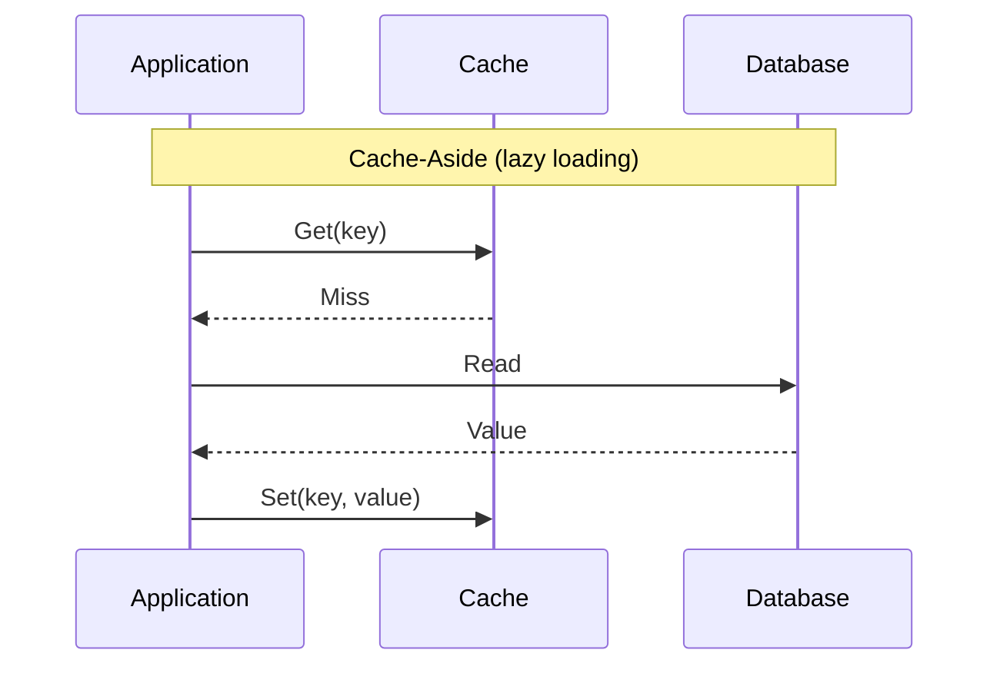

# Caching

## 1. What is Caching?

Caching stores a copy of frequently-accessed data somewhere faster to read
than its source of truth — usually in memory, in front of a database or
an expensive computation — so most requests never have to reach the
slower system at all.

## 2. Why It Exists

A database that could serve every read directly, at the latency and
volume real traffic demands, wouldn't need a cache. In practice, databases
are slower than memory and shared across all traffic, so read-heavy
systems (the common case — see
[Requirements & Estimation §9](../requirements-estimation/index.md#9-readwrite-ratio-and-why-it-matters))
get disproportionate benefit from serving hot data without touching the
database at all.

## 3. Cache Strategies

How the cache is kept in sync with the source of truth is the central
design decision — each strategy makes a different trade-off between read
performance, write performance, and staleness risk.

| Strategy | How it works | Trade-off |
| -------- | -------------- | ----------- |
| **Cache-aside** | App checks cache first; on a miss, reads the DB and populates the cache | Simple and widely used; first request after expiry always misses |
| **Read-through** | The cache itself loads from the DB on a miss, transparently to the app | Simpler app code; couples the cache to the DB access logic |
| **Write-through** | Writes go to the cache, which synchronously writes to the DB | Cache is never stale; every write pays DB latency |
| **Write-behind (write-back)** | Writes go to the cache, which asynchronously flushes to the DB | Fastest writes; risk of data loss if the cache fails before flushing |

!!! tip "Quick Mental Model"
    Cache-aside answers "did we already look this up?" Write-through and
    write-behind answer "is the cache allowed to be the only place this
    write has landed, even briefly?" — that's a durability question, not
    just a performance one.

## 4. Eviction & TTL

A cache has finite size, so something must decide what to remove:

* **TTL (time to live)** — an entry expires automatically after a fixed
  duration, bounding how stale it can get
* **LRU (Least Recently Used)** — evict the entry that hasn't been
  accessed in the longest time, on the assumption that recently-accessed
  data is likely to be accessed again

TTL bounds staleness; eviction policy decides what to keep when the cache
is full — most production caches use both together.

## 5. Cache Failure Modes

These three failure modes look similar (both involve the cache "not
helping") but have different causes and different fixes:

| Failure Mode | What happens | Typical fix |
| -------------- | --------------- | -------------- |
| **Cache stampede** | Many requests miss the cache simultaneously (e.g. a popular key expires) and all hit the DB at once | Lock/single-flight the recompute so only one request repopulates the cache; stagger TTLs |
| **Cache penetration** | Requests for keys that don't exist in the DB either, so they never get cached and always hit the DB | Cache the "not found" result too (with a short TTL), or use a bloom filter to reject impossible keys early |
| **Cache avalanche** | A large number of unrelated keys expire at the same moment (e.g. all set with the same TTL at startup), causing a simultaneous surge to the DB | Add jitter to TTLs so expirations spread out over time |

!!! danger "Common Trap"
    Setting the same fixed TTL on every key populated during a deploy or
    a cache warm-up. They'll all expire together later — turning a
    scheduled cache refresh into a scheduled stampede.

## 6. Distributed Caching

A single-instance cache (in-process memory) is fast but not shared across
application instances — each instance has its own copy, and invalidating
one doesn't invalidate the others. A distributed cache (e.g. a dedicated
cache cluster) is shared across all app instances, at the cost of a
network hop instead of an in-process lookup. Most systems at real scale
use a distributed cache for this reason, sometimes with a small
in-process cache layered in front of it for the very hottest keys.

## 7. CDN Caching

A CDN (see [Core Building Blocks §6](../building-blocks/index.md#6-cdn))
is caching applied at the network edge rather than in front of the
database — same core ideas (TTL, invalidation, staleness trade-offs), but
caching whole responses close to the user instead of caching query
results close to the database.

## 8. Common Mistakes

* Caching without a clear invalidation strategy — a stale cache silently
  serving wrong data is worse than no cache, because it's harder to notice
* Treating the cache as the source of truth and losing data when it's
  evicted or restarted (only safe with write-through/write-behind and an
  understanding of the durability trade-off)
* Fixed, synchronized TTLs across many keys, inviting a stampede or
  avalanche
* Caching everything uniformly instead of the actually-hot subset of data
  — most access patterns follow a power law, and caching the long tail
  wastes cache capacity for little benefit

## 9. Related Concepts

* [Core Building Blocks](../building-blocks/index.md) — where caching and
  CDN sit in the request path
* [Scalability](../scalability/index.md) — caching as one of the
  highest-leverage scaling techniques
* [Data & Databases](../data-databases/index.md) — the source of truth a
  cache sits in front of
