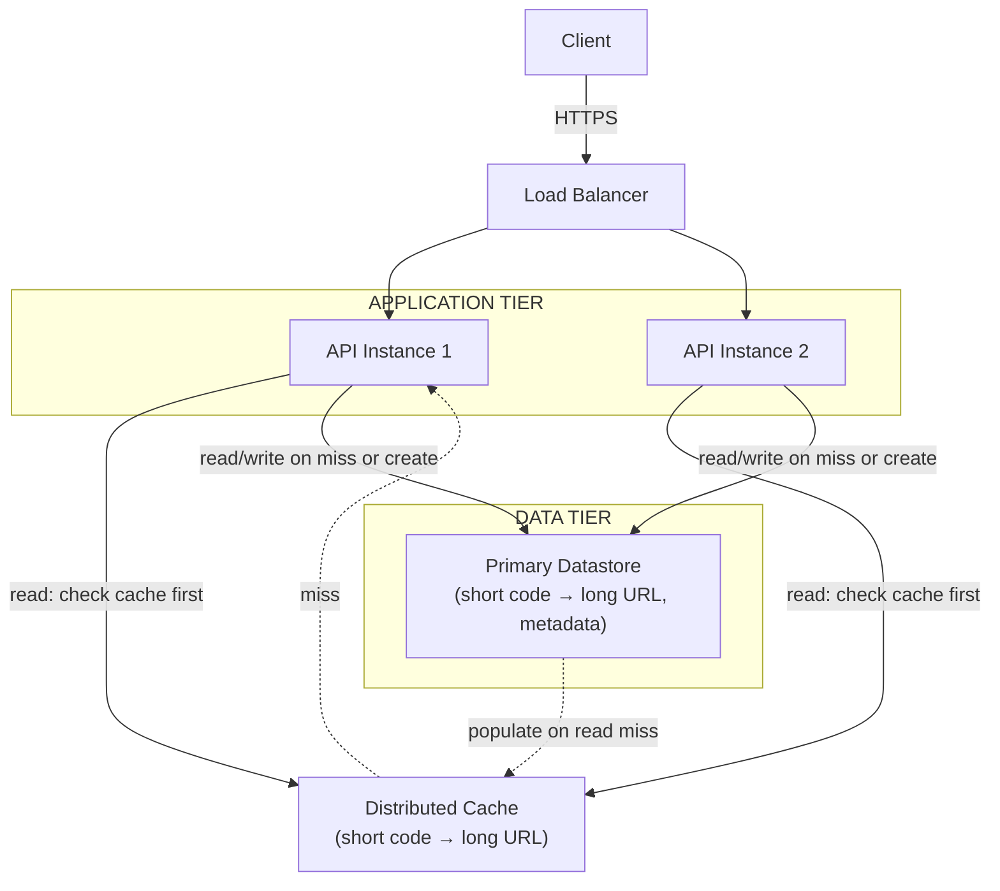
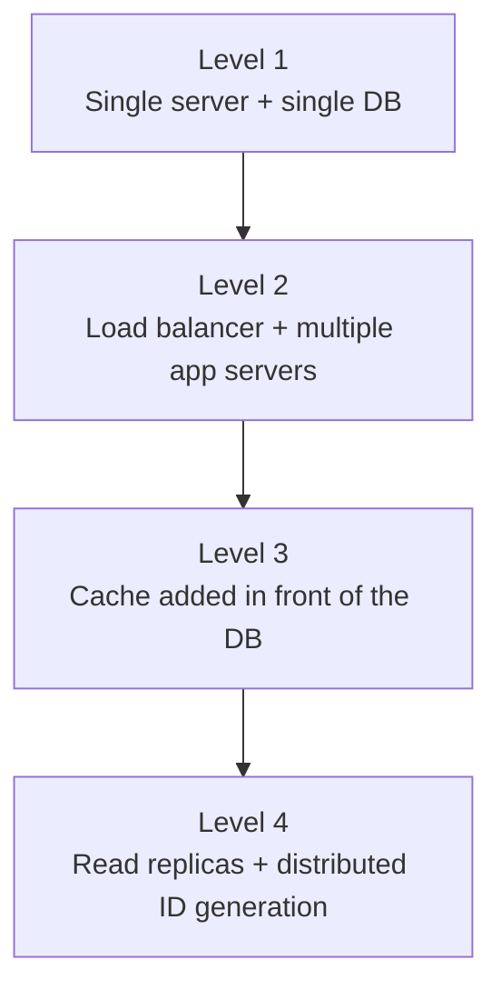

# Detailed Architecture

## 1. Architecture Overview

The system separates two paths with very different traffic profiles,
identified in the [Overview](index.md)'s capacity estimation: a low-volume
write path that creates short URLs, and a high-volume read path that
redirects them. The architecture is shaped around serving the read path
almost entirely from cache.

---

## 2. High-Level Architecture

---

## 3. API Design

| Endpoint | Method | Purpose |
| -------- | ------ | --------- |
| `/api/v1/shorten` | POST | Accepts a long URL, returns a generated short URL |
| `/{shortCode}` | GET | Redirects to the long URL for the given short code |
| `/api/v1/urls/{shortCode}` | GET | Returns metadata for a short code (creation date, expiry, click count) — not the redirect itself |

The redirect endpoint (`GET /{shortCode}`) is deliberately at the domain
root, not under `/api/`, so that short URLs handed to end users are as
short as possible.

---

## 4. Data Model

| Field | Type | Notes |
| ----- | ---- | ------- |
| `short_code` | string (7 chars) | Primary key |
| `long_url` | string | The original URL |
| `created_at` | timestamp | |
| `expires_at` | timestamp (nullable) | Null means no expiry |
| `click_count` | integer | Eventually consistent — see [Availability](availability.md) |

---

## 5. Short Code Generation Strategy

| Strategy | How it works | Trade-off |
| -------- | -------------- | ----------- |
| **Base62 encoding of an auto-incrementing ID** (chosen) | A centrally-generated unique integer ID is encoded into base62 characters | Guarantees uniqueness without a collision check; the ID generator itself must be highly available |
| Hash the long URL (e.g. MD5, truncated) | Deterministic — the same URL always maps to the same code | Collisions are possible and must be detected and handled (e.g. append a character and rehash) |
| Pre-generated pool of random codes | A pool of unused codes is generated in advance and handed out on request | Avoids a live ID generator, at the cost of managing and refilling the pool |

The full reasoning and rejected alternatives are recorded in
[ADR-001](decisions.md#adr-001-use-base62-encoding-of-an-auto-incrementing-id).

---

## 6. Component Responsibilities

### Application Tier

* Validate submitted URLs (see [Security](security.md))
* On create: request a new ID, encode it, write the mapping, return the
  short URL
* On redirect: check the cache, fall back to the datastore on a miss,
  populate the cache, issue the HTTP redirect

### Cache

* Serves the overwhelming majority of redirect requests without touching
  the datastore, per the 100:1 read/write ratio from the
  [Overview](index.md#capacity-estimation)
* Cache-aside strategy, per [Caching §3](../../caching/index.md#3-cache-strategies)

### Primary Datastore

* Source of truth for the short-code-to-URL mapping
* Sized for the ~8.4 TB, 5-year estimate from the
  [Overview](index.md#capacity-estimation)

---

## 7. Architecture Evolution

* **Level 1 → 2**: a single server can't meet the availability
  requirement (any redirect failure is a broken link for an end user) —
  multiple app servers behind a load balancer remove the single point of
  failure, per [Scalability §4](../../scalability/index.md#4-scaling-the-application-tier)
* **Level 2 → 3**: at the estimated peak of ~11,700 reads/second, hitting
  the datastore for every redirect is unnecessary and expensive — a cache
  absorbs the vast majority of that traffic, per
  [Caching](../../caching/index.md)
* **Level 3 → 4**: once write volume or storage outgrows a single
  datastore instance, read replicas (per
  [Scalability §5](../../scalability/index.md#5-scaling-the-database-read-replicas))
  and a distributed ID generator (avoiding a single ID-generation
  bottleneck/single point of failure) become necessary

This system's estimated numbers (39 writes/second, ~11,700 peak
reads/second) comfortably fit Level 3 — Level 4 is included to show where
the design goes next if scale grows well beyond this case study's
assumptions, not because it's required here.

---

## 8. Architecture Scope

This case study focuses on the core shorten/redirect flow. The following
are explicitly out of scope, consistent with the
[Overview](index.md#constraints-assumptions):

* Custom aliases / vanity URLs
* Full analytics (referrer tracking, geographic breakdown)
* Abuse detection beyond basic rate limiting (see [Security](security.md))
