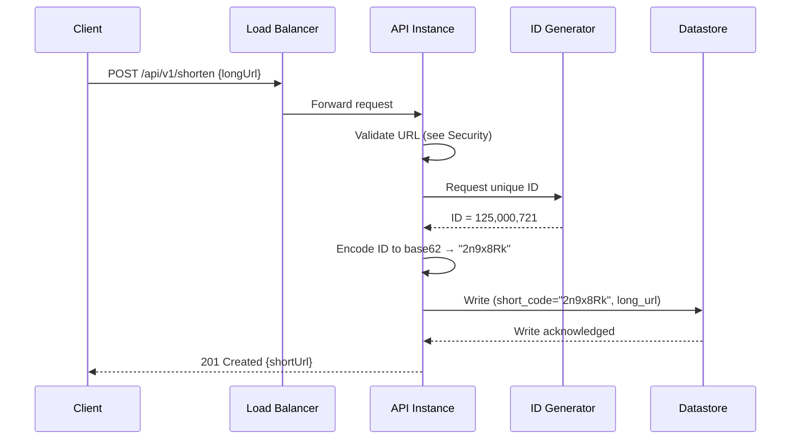
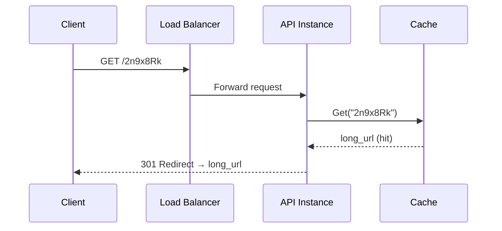
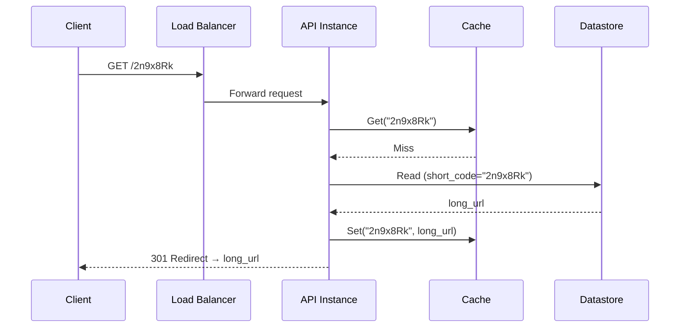

# Data Flow

## 1. Write Path: Creating a Short URL

The write path is deliberately synchronous end-to-end — at 39 writes/second
(average, per the [capacity estimation](index.md#capacity-estimation)),
there's no volume that justifies the added complexity of an asynchronous
write path.

---

## 2. Read Path: Redirecting a Short URL (Cache Hit)

This is the overwhelmingly common path, per the 100:1 read/write ratio —
the datastore is never touched.

---

## 3. Read Path: Redirecting a Short URL (Cache Miss)

A miss happens on the first request for a given code, or after it's
evicted (see [Caching §4](../../caching/index.md#4-eviction-ttl)). The
cache-aside pattern (per
[Caching §3](../../caching/index.md#3-cache-strategies)) populates the
cache on the way out, so the *next* request for the same code is a hit.

---

## 4. Click Count Update

`click_count` (see [Architecture §4](architecture.md#4-data-model)) is
updated asynchronously rather than as part of the redirect's critical
path — the redirect response is returned to the client immediately, and
the count increment is applied afterward, so a slow or failing analytics
write never delays or breaks a redirect. See
[Availability §4](availability.md#4-eventually-consistent-click-counts)
for the consistency trade-off this implies.
