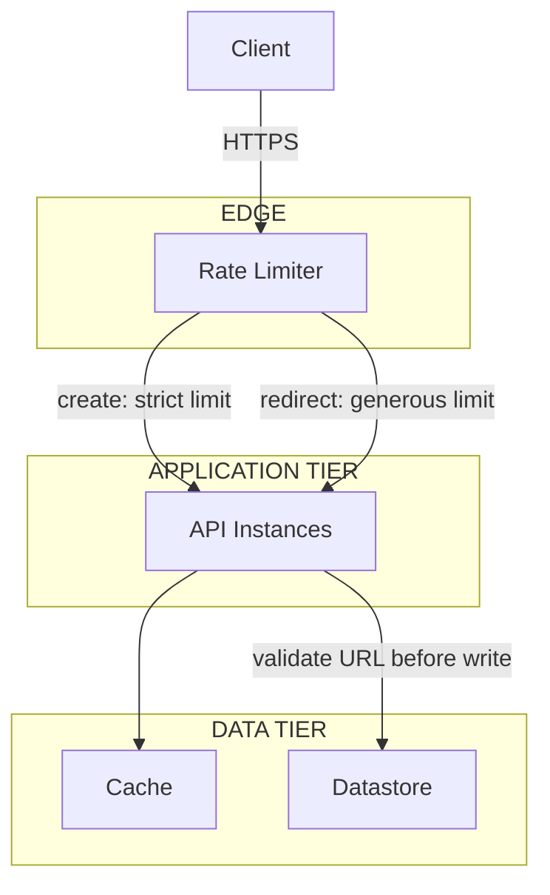

# Security

## 1. Security Overview

A URL shortener's threat model is different from a typical CRUD API: the
write endpoint accepts an arbitrary URL from anyone, and the read endpoint
redirects anonymous traffic to wherever that URL points. Most of the
security concerns here follow from that shape, more than from the usual
authentication/authorization surface.

---

## 2. URL Validation

The create endpoint must validate the submitted long URL before storing
it:

* Reject malformed URLs and unsupported schemes (only `http`/`https`)
* Reject URLs pointing at internal/private IP ranges, to prevent the
  service being used as a proxy into internal infrastructure (a
  server-side request forgery risk if any part of the system ever fetches
  the URL server-side, e.g. for preview generation)
* Optionally check against a known-malware/phishing URL blocklist before
  accepting

!!! danger "Common Trap"
    Treating URL shortening as a pure storage problem with no validation.
    An unvalidated shortener becomes an attractive vector for phishing —
    the short domain's reputation is spent hiding the real destination
    from the person clicking it.

---

## 3. Rate Limiting

Both endpoints need rate limiting, for different reasons:

* **Create endpoint** — without a limit, the endpoint can be used to
  exhaust the short-code space or flood the datastore with junk records;
  apply per-IP or per-API-key limits using the token bucket approach from
  [APIs & Communication §5](../../apis-communication/index.md#5-rate-limiting-throttling)
* **Redirect endpoint** — a legitimate short URL can go viral and see a
  huge, valid traffic spike; this should rely on the caching and scaling
  strategy in [Architecture](architecture.md), not a rate limit that would
  reject real users

---

## 4. Redirect Safety

The redirect response itself should avoid leaking anything about the
internal system (e.g. internal error details on a lookup failure) and
should use a `301`/`302` distinction deliberately: a `301` (permanent) is
cached by browsers and search engines, which is desirable for a stable
mapping but makes it harder to redirect a previously-shortened URL
elsewhere later if needed (e.g. to a warning page for a URL later found
to be malicious).

---

## 5. Security Architecture

---

## 6. Common Mistakes

* No validation on the submitted long URL, enabling phishing/SSRF abuse
* One rate limit applied uniformly to both endpoints, either throttling
  legitimate viral traffic on redirects or leaving the create endpoint
  unprotected
* Using `301` redirects by default without considering that a
  since-flagged-malicious URL becomes hard to intercept once heavily
  cached by clients and search engines
