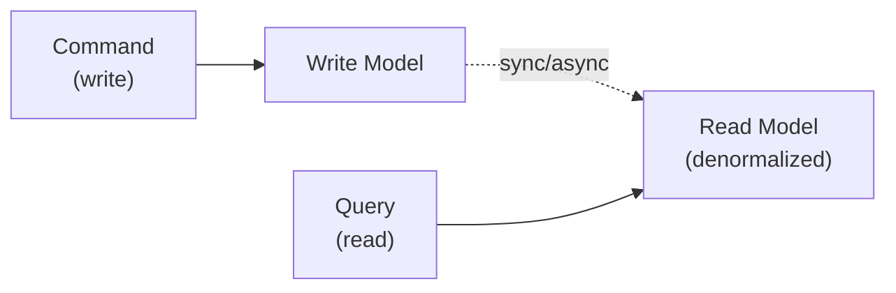
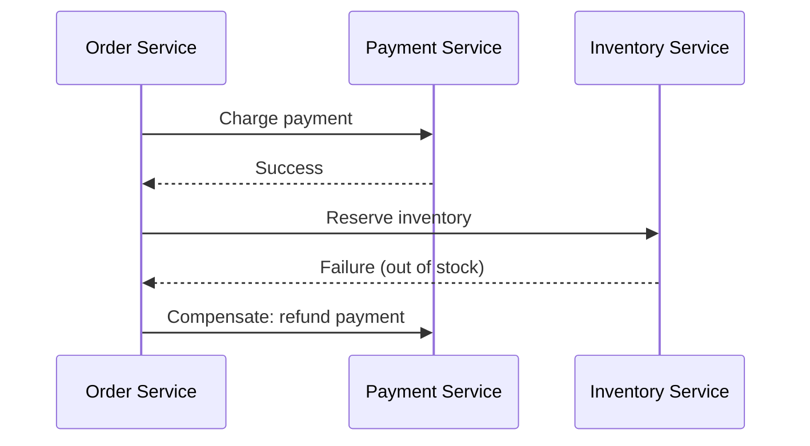

# Design Patterns

## 1. What Are System Design Patterns?

These are recurring shapes for organizing an entire system — how services
are divided, how they communicate, and how state is managed — as distinct
from the individual [Core Building Blocks](../building-blocks/index.md)
those services are made of. A pattern here is a decision about the whole
architecture's structure, not one component in it.

## 2. Why They Exist

Every pattern below is a response to a specific pain point that shows up
once a system grows past what its current structure comfortably handles —
a monolith that's become too large for one team to safely deploy, a
service graph where nobody can trace a request's actual data flow, a
migration that would otherwise require a risky big-bang rewrite. None of
them are defaults; each is a trade of one set of problems for another.

## 3. Layered / N-Tier Architecture

The most common starting shape: presentation, business logic, and data
layers, each depending only on the layer below it. See the
[Three-Tier LAMP architecture](../../architecture/three-tier-lamp/architecture.md)
for this pattern applied to a real platform, with the full trade-off
discussion in its [decisions](../../architecture/three-tier-lamp/decisions.md).

## 4. Microservices vs Modular Monolith

| | Microservices | Modular Monolith |
| --- | --- | --- |
| Deployment | Each service deployed independently | Single deployable unit |
| Team scaling | Teams own services independently | Teams share one codebase, coordinate releases |
| Failure isolation | A failing service doesn't crash others (with the [Resilience](../resilience/index.md) patterns in place) | A bug can affect the whole process |
| Data consistency | Cross-service transactions are hard (see Saga, §8) | In-process transactions are simple |
| Operational cost | Higher — many deployables, network calls, distributed tracing needed | Lower — one thing to deploy, monitor, debug |
| When it earns its cost | Independent team scaling and independent deploy cadence are the actual bottleneck | Almost always the right starting point |

!!! danger "Common Trap"
    Adopting microservices for technical reasons (scalability) when the
    actual problem is organizational (teams stepping on each other in one
    codebase) — a modular monolith with clean internal boundaries solves
    the organizational problem without paying the distributed-systems tax.

## 5. Event-Driven Architecture

Services communicate primarily by publishing and reacting to events
rather than calling each other directly — built on the
[Messaging & Events](../messaging-events/index.md) building blocks.
Loosens coupling between services (a publisher doesn't need to know who's
listening) at the cost of a request's full effect being harder to trace
by reading code alone — it's spread across whichever services happen to
be subscribed.

## 6. CQRS

**Command Query Responsibility Segregation** splits the model used for
writes (commands) from the model used for reads (queries) — often backed
by different data stores, each optimized for its side.



**Trade-off:** the read model can be shaped exactly for query performance
(denormalized, pre-aggregated) without compromising the write model's
integrity — at the cost of the two models needing to be kept in sync,
usually asynchronously, reintroducing the staleness trade-offs from
[Caching](../caching/index.md).

## 7. Event Sourcing

Instead of storing current state, event sourcing stores the full sequence
of events that led to it — current state is derived by replaying events.
Pairs naturally with CQRS (the write side appends events; the read side
is a projection of them).

**Trade-off:** a complete audit trail and the ability to reconstruct state
at any point in time, at the cost of query complexity (you can't just
`SELECT` current state — it must be projected) and the operational
overhead of managing event schema evolution over the system's lifetime.

## 8. Saga Pattern

A saga coordinates a transaction that spans multiple services — where a
traditional ACID transaction (see
[Data & Databases §3](../data-databases/index.md#3-relational-databases))
isn't available, because the data lives in separate services/databases.
Each step has a compensating action to undo it if a later step fails:



**Trade-off:** avoids distributed locking across services, at the cost of
having to design and test a compensating action for every step — and
accepting that the system passes through intermediate, not-yet-consistent
states while the saga is in progress (eventual consistency, per
[Fundamentals §4](../fundamentals/index.md#4-core-quality-attributes)).

## 9. Strangler Fig Pattern

For migrating a legacy system without a risky big-bang rewrite: new
functionality is built as a new service, and a routing layer gradually
redirects traffic from the old system to the new one, piece by piece,
until nothing routes to the legacy system and it can be retired.

```text
Stage 1: All traffic → Legacy System
Stage 2: Some routes → New Service, rest → Legacy System
Stage 3: Most routes → New Service, remainder → Legacy System
Stage 4: All traffic → New Service (legacy retired)
```

## 10. Sidecar & Service Mesh

A **sidecar** is a helper process deployed alongside a service instance
that handles cross-cutting concerns (mTLS, retries, observability) so the
service code doesn't have to implement them itself. A **service mesh**
is a fleet of sidecars managed centrally, giving uniform
[Resilience](../resilience/index.md) and
[Observability](../observability/index.md) behavior across every service
without each team reimplementing it.

**Trade-off:** consistent cross-cutting behavior and less duplicated
code, at the cost of an extra network hop per call and another
operational system (the mesh control plane) to run and understand.

## 11. Backend for Frontend (BFF)

A dedicated backend layer per frontend (web, mobile, etc.), each shaped to
that frontend's specific needs, rather than one general-purpose API every
client has to adapt to. Reduces over/under-fetching per client at the
cost of some duplicated logic across BFFs.

## 12. Cell-Based Architecture

The system is partitioned into independent, self-contained "cells," each
serving a subset of users/traffic with its own full stack (app tier,
data, dependencies). A failure in one cell is contained to the users it
serves — a direct application of the failure-domain thinking in
[Availability & Reliability §4](../availability-reliability/index.md#4-redundancy-failure-domains)
at the scale of the whole architecture, not just one component.

## 13. Choosing a Pattern

| Problem | Pattern to consider |
| ------- | ---------------------- |
| One codebase, multiple teams stepping on each other | Modular monolith first; microservices only if independent deploy cadence is the actual blocker |
| Read and write load have very different shapes | CQRS |
| Need a full audit trail / point-in-time reconstruction | Event Sourcing |
| A business transaction spans multiple services | Saga |
| Migrating a legacy system without a risky rewrite | Strangler Fig |
| Cross-cutting concerns duplicated across every service | Sidecar / Service Mesh |
| One API poorly serving very different clients | Backend for Frontend |
| One bad tenant/region must not affect all others | Cell-Based Architecture |

## 14. Common Mistakes

* Adopting CQRS or Event Sourcing for a simple CRUD system with no read/write
  asymmetry or audit requirement to justify the added complexity
* A saga with no compensating action defined for a step that can fail
* A service mesh adopted before there are enough services to make the
  operational cost worth it
* Confusing a sidecar/service mesh's consistency benefits with actual
  fault isolation — a mesh standardizes resilience patterns, it doesn't
  replace the [Resilience](../resilience/index.md) design itself

## 15. Related Concepts

* [Architecture](../../architecture/index.md) — the layered/n-tier pattern
  applied end-to-end, with recorded ADRs
* [Resilience](../resilience/index.md) and
  [Observability](../observability/index.md) — the cross-cutting concerns a
  service mesh centralizes
* [Messaging & Events](../messaging-events/index.md) — the building block
  event-driven architecture and sagas are built from
* [Architecture Decision Making](../decision-making/index.md) — worked
  examples of choosing between some of these patterns
