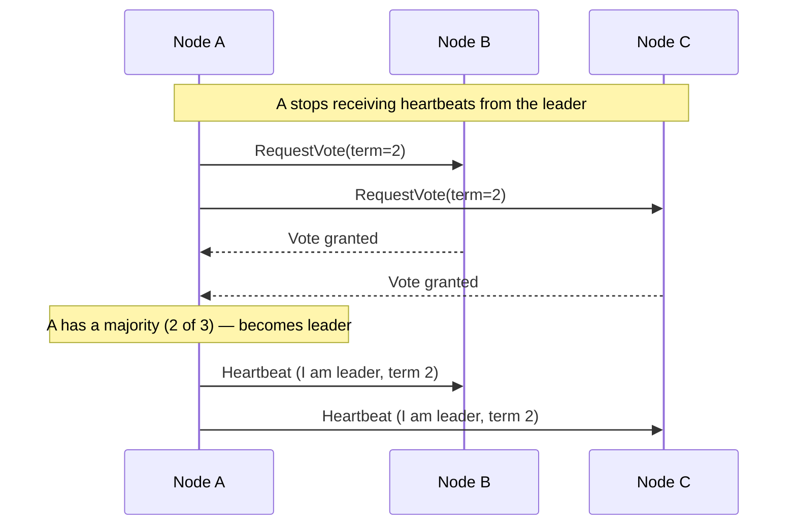
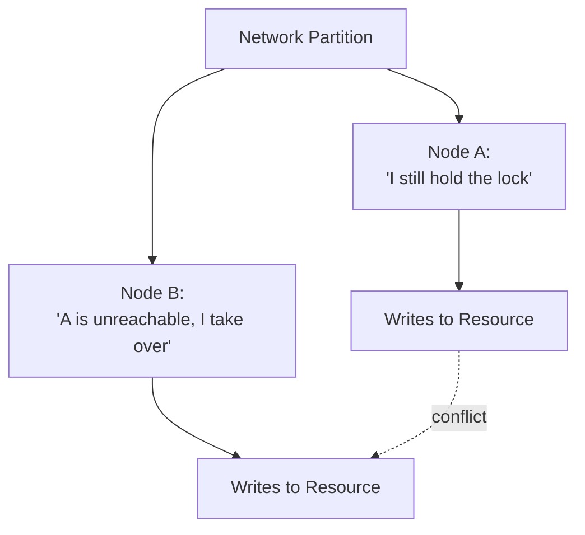

# Distributed Systems

This is the deepest topic in the track — most of scalability, availability,
caching, and messaging rest on the concepts here. It's placed after those
introductory topics deliberately, so the *problems* being solved (scaling,
failover, replication) are already familiar before diving into why they're
hard.

## 1. What Makes Distributed Systems Different?

A single-machine program either runs or crashes — there's no ambiguity. A
distributed system spans multiple machines connected by a network, and
the network introduces failure modes a single machine never has: messages
that are delayed, dropped, duplicated, or reordered, and machines that
fail independently of one another, at any time, in any combination.

## 2. Why This Is Hard

The classic list of assumptions that don't hold in a distributed system
(the "fallacies of distributed computing") includes: the network is
reliable, latency is zero, bandwidth is infinite, the network is secure,
topology doesn't change, and there is one administrator. Every technique
in this page exists because code that assumes any of these breaks in
production.

!!! danger "Common Trap"
    Treating a remote call like a local function call. A local call either
    returns or the process crashes; a remote call can also **time out with
    no way to know if it succeeded** — the request may have been processed
    and only the response lost. This single fact is why idempotency
    (§9) matters so much.

## 3. Network Failures & Partial Failures

A **partial failure** is when part of a system fails while the rest keeps
running — the defining characteristic of distributed systems, and the
reason they're harder to reason about than a single machine that either
works or doesn't. Worse, a slow component is often indistinguishable from
a failed one from the caller's point of view, which is why timeouts (see
the future Resilience topic) are necessary even though they're an
imperfect signal.

## 4. Time and Clocks

Machines don't agree on time. Physical clocks drift and NTP synchronization
is never perfect, so comparing timestamps across machines to determine
"what happened first" is unreliable. Two alternatives are used instead:

* **Logical clocks (Lamport clocks)** — a counter incremented on each
  event, giving a consistent *ordering* of events without needing
  synchronized wall-clock time
* **Vector clocks** — extend logical clocks to detect whether two events
  are causally related or genuinely concurrent, at the cost of more
  bookkeeping (one counter per node)

## 5. Consensus & Leader Election

**Consensus** is getting multiple nodes to agree on a single value (e.g.
"who is the leader," or "what is the next entry in a replicated log")
despite failures and network issues. **Leader election** is the most
common practical application: nodes agree on one coordinator so that, for
example, writes have a single ordering.



Algorithms like Raft and Paxos formalize this so that exactly one leader
is elected even if messages are delayed or nodes fail mid-election —
getting this right without a proven algorithm is notoriously easy to get
subtly wrong.

## 6. Replication Strategies

| Strategy | How it works | Trade-off |
| -------- | -------------- | ----------- |
| Leader-follower (single-leader) | All writes go through one leader, replicated to followers | Simple ordering guarantees; leader is a bottleneck and failover point |
| Multi-leader | Multiple nodes accept writes, replicated to each other | Better write availability across regions; conflicting concurrent writes must be resolved |
| Leaderless | Any node accepts reads/writes; quorum reconciles consistency | No single point of failure; more complex read/write path (§7) |

## 7. Quorum

In leaderless or multi-node replication, a **quorum** is the minimum
number of nodes that must acknowledge an operation for it to be considered
successful. With `N` total replicas, `W` nodes required to acknowledge a
write, and `R` nodes read from:

```text
If W + R > N, every read overlaps with the most recent write's set of
acknowledgments — the read is guaranteed to see it.

Example: N = 3, W = 2, R = 2
  W + R = 4 > N = 3   → strong read consistency guaranteed
```

Lowering `W` or `R` trades consistency guarantees for lower latency and
higher availability during node failures — a direct expression of the CAP
trade-off from [Fundamentals §5](../fundamentals/index.md#5-cap-theorem).

## 8. Consistency Models

| Model | Guarantee | Example use case |
| ----- | ---------- | ------------------ |
| Strong consistency | Every read sees the latest write | Financial balances |
| Eventual consistency | Reads may be stale, but converge to the latest value given no new writes | Social media like counts |
| Read-after-write consistency | A user always sees their own writes immediately, though others may not yet | A user's own posted comment |
| Causal consistency | Operations that are causally related are seen in the same order by everyone; unrelated operations may be seen in different orders | Comment threads (a reply always appears after the comment it replies to) |

## 9. Idempotency

An operation is **idempotent** if performing it multiple times has the
same effect as performing it once. Because a distributed caller can never
be certain a request wasn't received just because the response was lost
(§3), retrying is often necessary — and safe to do only if the operation
is idempotent (e.g. "set balance to $100," not "add $10 to balance," or a
deduplication key attached to a non-idempotent operation).

## 10. Distributed Locks & Split Brain

A distributed lock coordinates exclusive access to a resource across
multiple nodes. **Split brain** occurs when a network partition causes two
nodes to each believe they hold the lock (or are the leader) simultaneously
— both act, and both may write conflicting data.



Split brain is why distributed locks need a fencing mechanism (e.g. a
monotonically increasing token checked by the resource itself) — the lock
holder believing it holds the lock isn't sufficient; the resource must be
able to reject a stale holder.

## 11. Gossip Protocols

Gossip protocols spread state (e.g. cluster membership, health) by having
each node periodically exchange what it knows with a few random peers,
rather than every node talking to every other node. Information
eventually reaches everyone without a central coordinator, at the cost of
propagation delay rather than immediate consistency — a deliberately
eventual-consistency approach to cluster coordination itself.

## 12. Common Mistakes

* Comparing timestamps from different machines to determine event order
* Assuming a timed-out request didn't take effect, and retrying a
  non-idempotent operation
* Building a "distributed lock" without a fencing token, leaving split
  brain unresolved even when detected
* Choosing leaderless replication for the availability benefit without
  accounting for the read-repair/quorum complexity it requires

## 13. Related Concepts

* [Fundamentals](../fundamentals/index.md) — CAP and PACELC, which this
  page's quorum and consistency-model sections make concrete
* [Availability & Reliability](../availability-reliability/index.md) —
  failover and health checking run into the same detection ambiguity
  covered in §3
* [Scalability](../scalability/index.md) — replication strategies here
  underpin the read-replica and sharding techniques covered there
