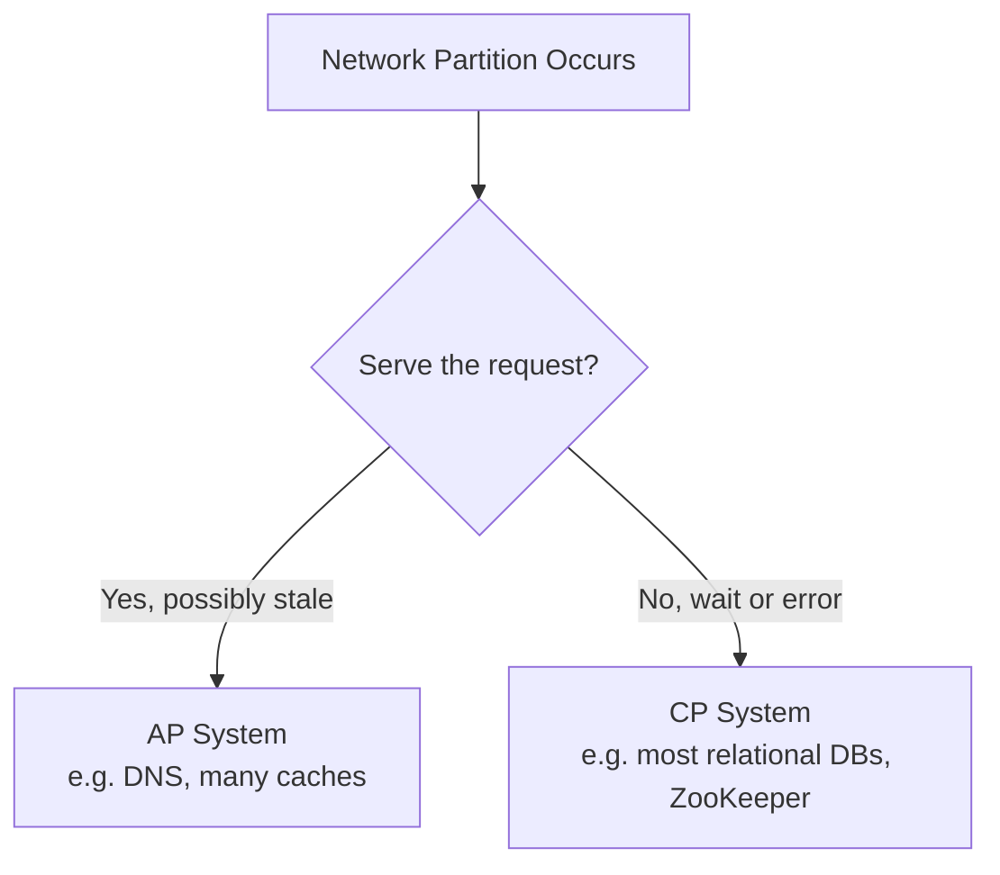
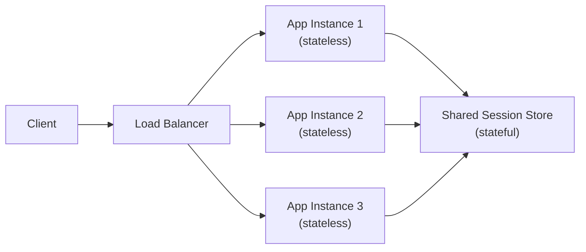

# System Design Fundamentals

## 1. What is System Design?

System Design is the practice of deciding how the pieces of a software
system fit together — which components exist, how they communicate, where
data lives, and how the system behaves under load, partial failure, and
growth. It sits between two other disciplines that are often confused with
it:

* **Software Design** decides how code inside one component is structured
  (classes, modules, functions).
* **System Design** decides how components — often running on different
  machines — work together to satisfy requirements.
* **Solution Architecture** (see the [Architecture](../../architecture/index.md)
  track) goes further still: a specific solution, for a specific
  organization, with specific constraints, documented decisions, and an
  operating model.

## 2. System Design vs Software Design vs Solution Architecture

| | Software Design | System Design | Solution Architecture |
| --- | --- | --- | --- |
| Scope | Inside one application | Across services and infrastructure | A specific organization's platform |
| Typical question | How should this class be structured? | How does this system scale to 10M users? | Why did we choose Kubernetes over VMs here? |
| Output | Code structure, design patterns | Component diagram, data flow, capacity plan | ADRs, security model, availability plan |
| Constraints | Language, framework | Traffic, consistency, latency budgets | Budget, team, compliance, existing estate |

## 3. Functional vs Non-Functional Requirements

Every system design starts by separating **what the system must do**
(functional) from **how well it must do it** (non-functional):

| Functional Requirements | Non-Functional Requirements |
| ------------------------ | ----------------------------- |
| Users can create an account | The system must respond in under 200ms (p99) |
| Users can upload a photo | The system must be available 99.95% of the time |
| Orders can be placed and tracked | The system must support 10,000 requests/second at peak |
| Messages are delivered to the recipient | Data must not be lost once an order is confirmed |

Non-functional requirements are what turn a working prototype into a
system that survives production. Most of this track exists to teach how to
satisfy them.

!!! note "Interview Angle"
    Interviewers deliberately leave requirements vague. The first thing a
    strong candidate does is state assumptions and non-functional targets
    explicitly, rather than silently designing for an unstated scale.

## 4. Core Quality Attributes

These terms recur throughout every later topic — get them precise now
rather than treating them as interchangeable.

| Term | Definition | Often confused with |
| ---- | ----------- | -------------------- |
| **Scalability** | The system's ability to handle growth in load by adding resources | Performance (scalability is about *growth*, not raw speed) |
| **Availability** | The proportion of time the system is operational and responsive | Reliability (a system can be available but returning wrong answers) |
| **Reliability** | The system performs its intended function correctly over time | Availability (a system can be "up" but broken) |
| **Performance** | How fast the system responds under a given load | Throughput (performance is usually about latency, not volume) |
| **Latency** | Time to complete a single operation | Throughput |
| **Throughput** | Number of operations completed per unit of time | Latency |
| **Durability** | Once data is written, it survives failures | Consistency (durable data can still be temporarily inconsistent) |
| **Consistency** | All readers see the same data at the same time (to varying degrees) | Durability |
| **Fault Tolerance** | The system keeps working when a component fails | Resilience (fault tolerance masks failure; resilience recovers from it) |
| **Resilience** | The system detects, contains, and recovers from failure | Fault Tolerance |

!!! danger "Common Trap"
    Treating "highly available" and "reliable" as synonyms. A system that
    returns HTTP 200 with corrupted data is available and unreliable at
    the same time — availability metrics alone won't catch this.

## 5. CAP Theorem

In a distributed system, when a **network partition** occurs — some nodes
can't talk to others — you must choose between:

* **Consistency** — every read gets the most recent write, or an error
* **Availability** — every request gets a (possibly stale) response

You cannot have both during the partition. **Partition tolerance isn't
optional** in a real distributed system (networks fail), so CAP is really a
choice between **CP** and **AP** during a partition, not a three-way pick.

## 6. PACELC

CAP only describes behavior *during* a partition. **PACELC** extends it to
normal operation:

> If there is a **P**artition, choose between **A**vailability and
> **C**onsistency — **e**lse (no partition), choose between **L**atency and
> **C**onsistency.

Even with a healthy network, strongly consistent systems typically pay a
latency cost (coordinating with replicas before acknowledging a write).
This is why "just use strong consistency everywhere" is rarely free — it's
a trade-off made on every request, not just during failures.

## 7. Stateless vs Stateful Systems

* **Stateless** components keep no request-specific data between requests —
  any instance can handle any request. This is what makes horizontal
  scaling and load balancing simple.
* **Stateful** components (databases, session stores, in-memory caches)
  hold data that must be routed to consistently or replicated.

!!! warning "Production Reality"
    Storing session data in application-server memory is the single most
    common thing that quietly breaks horizontal scaling — it works fine
    with one instance in dev, then fails intermittently once a second
    instance is added, because a user's next request may land on a
    different server.

## 8. Horizontal vs Vertical Scaling

| | Vertical Scaling (Scale Up) | Horizontal Scaling (Scale Out) |
| --- | --- | --- |
| Method | Add CPU/RAM/disk to one machine | Add more machines |
| Ceiling | Hard hardware limit | Effectively unbounded |
| Complexity | Low — no architecture change | Higher — requires statelessness, load balancing, data partitioning |
| Downtime | Often requires a resize/reboot | Can add capacity without downtime |
| Cost curve | Gets expensive fast near the top | Roughly linear |
| Typical first move | Databases, before sharding is justified | Application/web tiers |

Most systems start with vertical scaling because it's simple, and adopt
horizontal scaling once a single machine's ceiling becomes the bottleneck
or availability requires more than one instance regardless of capacity.

## 9. Related Concepts

* [Requirements & Estimation](../requirements-estimation/index.md) — turning
  these quality attributes into concrete, measurable targets before
  designing anything
* [Core Building Blocks](../building-blocks/index.md) — the components used
  to actually deliver scalability and availability
* [Scalability](../scalability/index.md) and
  [Availability & Reliability](../availability-reliability/index.md) — the
  techniques built directly on the stateless-design and scale-up/scale-out
  concepts above
* [Distributed Systems](../distributed-systems/index.md) — CAP and PACELC
  made concrete with consensus, quorum, and consistency models
* [Architecture](../../architecture/index.md) — see these attributes applied
  to a specific, real platform with recorded trade-offs
