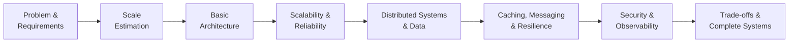

# System Design

This track is a structured System Design curriculum: a deliberate progression
from requirements and estimation through distributed systems, data
architecture, and complete production systems. Where the **Architecture**
track designs specific solutions end-to-end — a particular platform, with
ADRs recording why it was built that way — **System Design** teaches the
underlying concepts, trade-offs, and decision-making that any solution
architecture draws on.

Later topics build on earlier ones rather than standing alone. Estimation
feeds architecture decisions; architecture decisions expose bottlenecks;
bottlenecks motivate scalability, reliability, and distributed-systems
concepts; those in turn justify caching, messaging, resilience, security,
and observability.

---

## How This Track Works

Each topic explains *why* the concept exists — the engineering problem that
made it necessary — before explaining how it works. The goal is to be able
to justify an architectural decision, not just recognize a term.

---

## Topics

| Topic | Description | Status |
| ----- | ------------ | ------ |
| [Fundamentals](fundamentals/index.md) | Core vocabulary and quality attributes: scalability, availability, reliability, CAP/PACELC, stateless vs stateful, scale up vs scale out. | Active |
| [Requirements & Estimation](requirements-estimation/index.md) | How to start a system design problem: functional/non-functional requirements and back-of-envelope capacity estimation, worked in full. | Active |
| [Core Building Blocks](building-blocks/index.md) | The components that recur across almost every system — DNS, CDN, load balancers, gateways, databases, caches, queues — and the problem each one solves. | Active |
| [Scalability](scalability/index.md) | The scaling evolution from a single server to a distributed architecture: stateless app tiers, read replicas, sharding, consistent hashing, async processing, autoscaling. | Active |
| [Availability & Reliability](availability-reliability/index.md) | Redundancy, failover, replication, availability zones, disaster recovery (RTO/RPO), and graceful degradation. | Active |
| [Distributed Systems](distributed-systems/index.md) | Why distributed systems are hard: partial failure, clocks, consensus, quorum, consistency models, idempotency, split brain. | Active |
| [Data & Databases](data-databases/index.md) | Relational vs NoSQL fundamentals and a decision framework for choosing between them. | Active |
| [Caching](caching/index.md) | Cache strategies, eviction, and the stampede/penetration/avalanche failure modes. | Active |
| [Messaging & Events](messaging-events/index.md) | Queues vs pub/sub vs event streaming, delivery semantics, dead-letter queues. | Active |
| [APIs & Communication](apis-communication/index.md) | REST vs gRPC vs GraphQL, rate limiting algorithms, pagination, versioning, idempotency. | Active |
| [Security](security/index.md) | Security as an architectural concern: authn/authz, OAuth2/OIDC, TLS/mTLS, zero trust, controls shown on the diagram. | Active |
| [Observability](observability/index.md) | Logs, metrics, and traces; distributed tracing, SLIs/SLOs/SLAs, error budgets, alerting. | Active |
| [Resilience](resilience/index.md) | Timeouts, retry/backoff/jitter, circuit breakers, bulkheads, load shedding, and how they combine to prevent (or cause) cascading failures. | Active |
| [Design Patterns](design-patterns/index.md) | Microservices vs modular monolith, CQRS, event sourcing, saga, strangler fig, sidecar/service mesh, cell-based architecture. | Active |
| [Architecture Decision Making](decision-making/index.md) | Worked "why X over Y" ADRs — SQL vs NoSQL, Redis, Kafka vs RabbitMQ, sync vs async, microservices vs monolith, REST vs gRPC. | Active |
| [Case Studies](case-studies/index.md) | Full worked designs applying the whole track to one system, following the Architecture labs' Overview → Architecture → Data Flow → Security → Availability → Decisions structure. Starts with the URL Shortener. | Active |
| [Interview Preparation](interview-preparation/index.md) | A reusable 14-step framework and checklist, with every step linked back to where it's taught. | Active |

---

## Coming Next

Planned additions:

* More [case studies](case-studies/index.md#coming-next) — Rate Limiter, Notification System, Chat Application, and beyond

---

## How This Relates to Architecture

The [Architecture](../architecture/index.md) track and this track are
deliberately separate. Architecture labs are specific, opinionated
solutions with real constraints and recorded decisions. System Design here
is the reusable theory behind those decisions — read it to understand *why*
a lab made the choices it did, or independently as a curriculum in its own
right.
