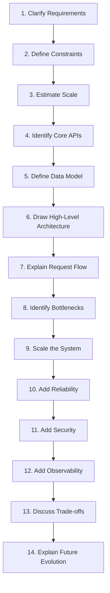

# Interview Preparation

## 1. What This Page Is

A System Design interview doesn't test whether you know a list of
technologies — it tests whether you can turn a vague prompt into
requirements, defend the trade-offs in your design, and reason clearly
under time pressure. This page is a reusable framework for that process,
not new material — every step below points back to where it's actually
taught elsewhere in this track.

## 2. The Framework

| Step | What to do | Where it's taught |
| ---- | ------------ | -------------------- |
| 1. Clarify Requirements | Separate functional from non-functional; state assumptions out loud | [Requirements & Estimation §3–4](../requirements-estimation/index.md#3-functional-requirements-checklist) |
| 2. Define Constraints | State what's explicitly out of scope | [Requirements & Estimation §3](../requirements-estimation/index.md#3-functional-requirements-checklist) |
| 3. Estimate Scale | RPS, storage, bandwidth — show the working, not just the answer | [Requirements & Estimation §6–8](../requirements-estimation/index.md#6-worked-example-requests-per-second) |
| 4. Identify Core APIs | The handful of endpoints the whole design serves | [APIs & Communication](../apis-communication/index.md) |
| 5. Define Data Model | The entities and their relationships, shaped by the access pattern | [Data & Databases](../data-databases/index.md) |
| 6. Draw High-Level Architecture | The building blocks, connected — start simple | [Core Building Blocks](../building-blocks/index.md) |
| 7. Explain Request Flow | Walk through one write and one read, end to end | The [URL Shortener](../case-studies/url-shortener/data-flow.md) case study is a model for this |
| 8. Identify Bottlenecks | Say out loud which component breaks first as load grows | [Scalability §2–3](../scalability/index.md#2-why-it-exists) |
| 9. Scale the System | Apply the scaling evolution — don't jump straight to the end state | [Scalability §3](../scalability/index.md#3-the-scaling-evolution) |
| 10. Add Reliability | Redundancy, failover, RTO/RPO | [Availability & Reliability](../availability-reliability/index.md) |
| 11. Add Security | AuthN/AuthZ and abuse prevention, shown on the diagram | [Security](../security/index.md) |
| 12. Add Observability | How you'd know the system was unhealthy | [Observability](../observability/index.md) |
| 13. Discuss Trade-offs | Justify the choices you made and name the alternatives you didn't pick | [Architecture Decision Making](../decision-making/index.md) |
| 14. Explain Future Evolution | What changes at 10x the scale | [Architecture Evolution example](../case-studies/url-shortener/architecture.md#7-architecture-evolution) |

## 3. A Reusable Checklist

Use this as a final pass before declaring a design "done" in an
interview:

- [ ] Did I state my assumptions instead of silently picking numbers?
- [ ] Did I show the estimation math, not just a final number?
- [ ] Does my data model match the access pattern I actually described?
- [ ] Did I explain *why* each component exists, not just name it?
- [ ] Did I identify the actual bottleneck before proposing a fix for it?
- [ ] Did I scale incrementally, or jump straight to a fully distributed
      architecture the requirements didn't justify?
- [ ] Did I address security and observability, or only the happy path?
- [ ] For every major decision, could I name the alternative I rejected
      and why?

## 4. Common Failure Modes in Interviews

!!! danger "Common Trap"
    Reaching for Kafka, sharding, and microservices in the first five
    minutes regardless of the stated scale. This reads as pattern-matching
    against "system design interview," not as engineering judgment — the
    strongest signal is choosing the *simple* answer when the requirements
    support it, and being able to say why you'd change your mind at a
    different scale.

* **Skipping estimation** — jumping straight to architecture without the
  numbers that would justify it
* **Silence during the design** — not narrating trade-offs as they're made
  leaves the interviewer unable to evaluate your reasoning, only your
  final diagram
* **Treating it as a memory test** — reciting a memorized design for "the
  URL shortener" instead of adapting it to the specific requirements and
  follow-up questions actually given
* **No mention of failure** — a design that's never asked "what happens
  when this component is down" hasn't demonstrated the reliability
  thinking interviewers are usually most interested in

## 5. Related Concepts

* [Requirements & Estimation](../requirements-estimation/index.md) — step 1–3
  in depth
* [Architecture Decision Making](../decision-making/index.md) — worked
  examples of the trade-off discussion in step 13
* [Case Studies](../case-studies/index.md) — full worked designs following
  this exact framework end to end
