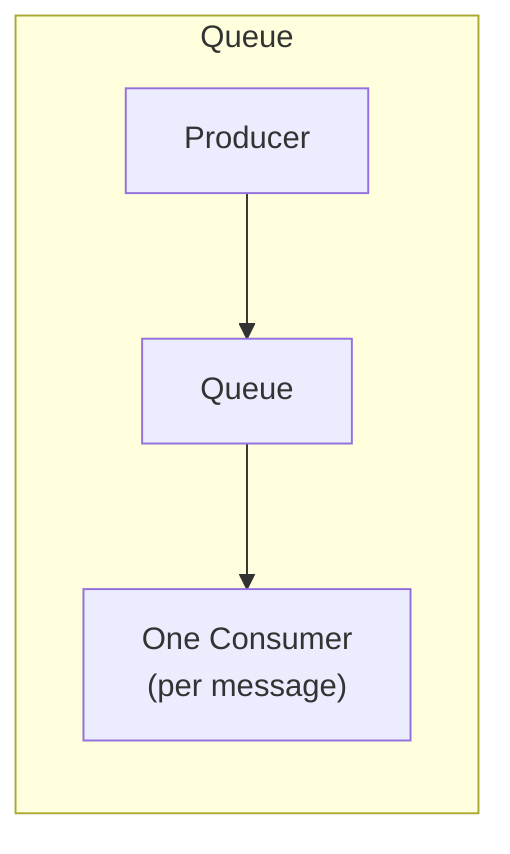
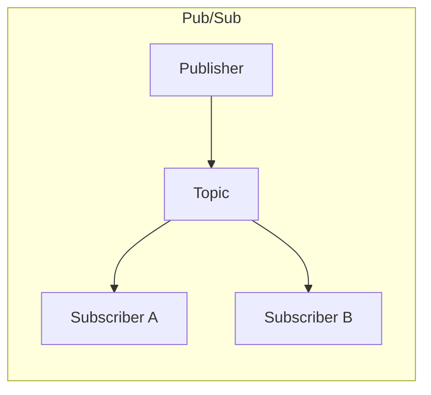
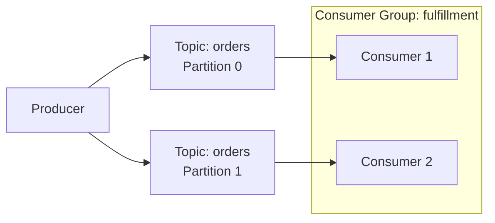

# Messaging & Events

## 1. What is Messaging & Event-Driven Architecture?

Messaging is communication where the sender doesn't wait for the receiver
to process the message before continuing — a message is handed off to an
intermediary (a queue, topic, or stream) and processed independently.
Event-driven architecture builds on this: instead of services calling each
other directly, services publish facts about what happened ("order
placed," "payment confirmed") and other services react to them.

## 2. Why It Exists

A synchronous call (see
[Core Building Blocks §8](../building-blocks/index.md#8-reverse-proxy-vs-api-gateway))
ties the caller's success to the callee's availability and speed right
now. That's fine when the caller genuinely needs the result before
continuing. It's a liability when it doesn't — a slow email service
shouldn't be able to make checkout fail. Messaging decouples "the work
happened" from "the work was acknowledged," letting each side scale,
fail, and deploy independently.

## 3. Message Queues vs Pub/Sub vs Event Streaming

These three are often used interchangeably in conversation but solve
different shapes of problem:





| | Message Queue | Pub/Sub | Event Streaming |
| --- | --- | --- | --- |
| Delivery | Each message consumed by exactly one consumer | Each message delivered to every subscriber | Consumers read from an ordered, replayable log |
| Message lifetime | Deleted once consumed | Not retained after delivery | Retained for a configured period, replayable |
| Typical use | Task distribution (one worker per job) | Fan-out notifications (multiple services react to one event) | Event sourcing, analytics, multiple independent consumers replaying history |
| Example | SQS-style job queue | SNS-style fan-out | Kafka-style log |

## 4. Producers, Consumers, Topics, Partitions, Consumer Groups

Event streaming systems (Kafka-style) add structure on top of pub/sub:



* **Topic** — a named stream of related events (e.g. `orders`)
* **Partition** — a topic is split into partitions for parallelism; each
  partition preserves message order, but order across partitions isn't
  guaranteed
* **Consumer group** — a set of consumers that split a topic's partitions
  between them, so each partition is processed by exactly one consumer in
  the group at a time — this is what lets consumption scale horizontally

## 5. Ordering Guarantees

Ordering is only guaranteed **within a partition**, not across an entire
topic. If two events must be processed in order relative to each other
(e.g. "order created" before "order shipped" for the same order), they
must be routed to the same partition — typically by keying on an entity
ID (e.g. order ID) so all of that entity's events land on one partition.

!!! danger "Common Trap"
    Assuming a topic is globally ordered because a single-partition test
    environment made it look that way. In production with multiple
    partitions, only same-key events are ordered relative to each other.

## 6. Delivery Semantics

| Semantic | Guarantee | Risk |
| --------- | ----------- | ------ |
| **At-most-once** | Message delivered zero or one times | Messages can be silently lost |
| **At-least-once** | Message delivered one or more times | Consumers may see duplicates — must be idempotent (see [Distributed Systems §9](../distributed-systems/index.md#9-idempotency)) |
| **Exactly-once** | Message delivered and processed exactly once | Hardest and most expensive to guarantee end-to-end; often actually "effectively-once" via at-least-once delivery plus idempotent processing |

Most production systems choose at-least-once delivery combined with
idempotent consumers, rather than paying for true exactly-once semantics —
the same practical outcome for much lower complexity.

## 7. Dead-Letter Queues, Retry & Backoff

When a consumer fails to process a message, the standard pattern is:

```text
Message fails processing
        ↓
Retry with exponential backoff
        ↓
Still failing after N attempts?
        ↓
Move to Dead-Letter Queue (DLQ)
        ↓
Alert / manual inspection
```

A **poison message** is one that will never succeed no matter how many
times it's retried (e.g. malformed data) — without a DLQ, a poison message
can block an entire partition behind it, or burn through retry budget
indefinitely. The DLQ isolates it so the rest of the stream keeps moving.

## 8. Choosing: REST vs Queue vs Pub/Sub vs Event Streaming

| Need | Choose |
| ---- | -------- |
| Caller needs the result immediately | Synchronous REST/gRPC call |
| Work should happen, but caller doesn't need to wait | Queue (task-style, one consumer per message) |
| Multiple services need to react to the same fact | Pub/Sub (fan-out) |
| Consumers need to replay history, or many independent readers at different paces | Event streaming |

## 9. Common Mistakes

* Using a queue for fan-out (only one consumer gets each message) when
  multiple services actually need to react to the same event
* Assuming exactly-once delivery instead of designing consumers to be
  idempotent
* No dead-letter queue, so one poison message stalls an entire partition
* Choosing event streaming's operational complexity (partition management,
  consumer group rebalancing) for a workload a simple queue would satisfy

## 10. Related Concepts

* [Core Building Blocks](../building-blocks/index.md) — where queues and
  streaming sit in the overall request path
* [Scalability](../scalability/index.md#9-asynchronous-processing-queue-based-scaling) —
  moving work off the synchronous path as a scaling technique
* [Distributed Systems](../distributed-systems/index.md) — idempotency and
  the partial-failure reasoning behind at-least-once delivery
* [Resilience](../resilience/index.md) — retry, backoff, and failure
  isolation patterns applied more broadly than just messaging
