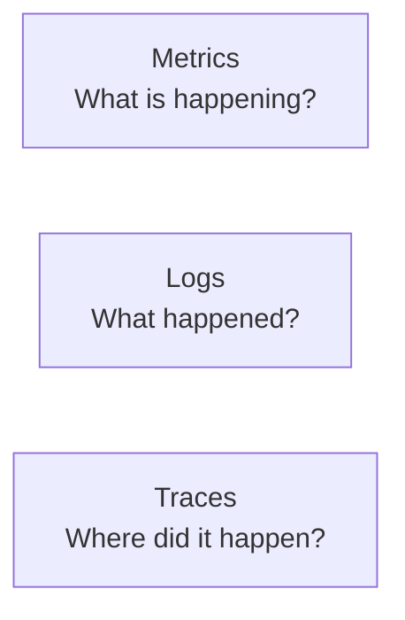
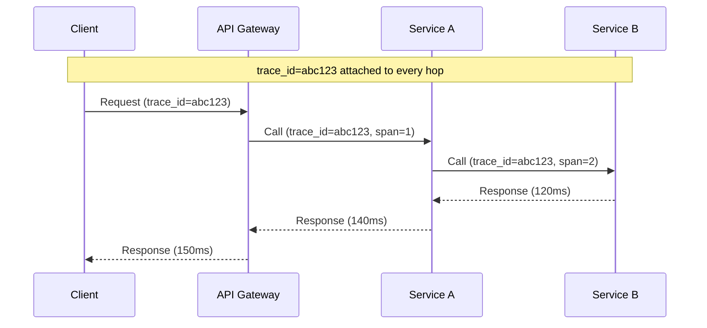

# Observability

## 1. What is Observability?

Observability is the ability to understand what's happening inside a
system from the outside, using the data it produces — without having to
ship new code to answer a new question about its behavior. It's a
prerequisite for operating anything covered earlier in this track:
[Availability & Reliability](../availability-reliability/index.md)'s
failover only works if failure is detected; a
[Distributed Systems](../distributed-systems/index.md) issue like split
brain is invisible without the data to notice it happened.

## 2. Why It Exists

**Monitoring** answers questions you already knew to ask (is CPU above
80%?). **Observability** is broader: it's having enough raw signal that
you can answer a question you *didn't* anticipate when an incident is
already in progress. As systems become more distributed, the number of
places something can go wrong grows, and guessing is no longer a viable
debugging strategy.

## 3. The Three Pillars

| Pillar | Answers | Granularity | Typical cost |
| ------ | -------- | ------------- | -------------- |
| **Metrics** | Is the system healthy right now? (aggregated numbers over time) | Low — numbers, not individual events | Cheap to store, cheap to query over long ranges |
| **Logs** | What exactly happened for this specific event? | High — full detail per event | Expensive at high volume; often sampled or filtered |
| **Traces** | Which service/call in a multi-service request was slow or failed? | High — the full path of one request | Moderate; usually sampled in high-traffic systems |

None of the three replaces another: a metric tells you error rate spiked,
a trace tells you which downstream call in the request path caused it,
and a log gives you the exact error message and stack trace from that
call.

## 4. Distributed Tracing & Correlation IDs

As introduced in
[APIs & Communication §10](../apis-communication/index.md#10-request-correlation),
a single client request in a multi-service system fans out into many
internal calls. **Distributed tracing** attaches a shared trace ID (and a
span ID per hop) to every call in that fan-out, so the full path — and
where time was spent — can be reconstructed after the fact.

Without the shared trace ID, correlating "this request was slow" across
independently-logging services means guessing based on timestamps —
unreliable, per
[Distributed Systems §4](../distributed-systems/index.md#4-time-and-clocks).

## 5. SLIs, SLOs, SLAs & Error Budgets

These build on each other:

| Term | Definition |
| ---- | ----------- |
| **SLI** (Indicator) | A measured metric, e.g. "% of requests served in under 200ms" |
| **SLO** (Objective) | An internal target for that SLI, e.g. "99.9% of requests under 200ms" |
| **SLA** (Agreement) | An external, often contractual, commitment — usually looser than the internal SLO, with consequences for missing it |
| **Error budget** | The allowed amount of SLO violation (e.g. the 0.1% in the example above) — a resource that can be deliberately spent on risk (a risky deploy, a migration) rather than something to always minimize to zero |

!!! tip "Quick Mental Model"
    An error budget reframes reliability as a budget to spend, not just a
    target to hit — 100% reliability isn't free, and an error budget makes
    the cost of the last fraction of a percent an explicit trade-off
    against velocity, rather than an unstated assumption.

## 6. Alerting & Health Checks

Alerting turns observability data into action — but only when tied to
something that actually requires a response. This connects directly to
[Availability & Reliability §6](../availability-reliability/index.md#6-failover-health-checks-heartbeats):
health checks feed both automated failover and human alerting from the
same underlying signal.

!!! danger "Common Trap"
    Alerting on every metric crossing a threshold, rather than on
    symptoms that indicate real user impact (SLO burn). This produces
    alert fatigue — the on-call engineer starts ignoring alerts, which
    defeats the purpose of alerting on the one that matters.

## 7. Synthetic Monitoring & APM

* **Synthetic monitoring** runs scripted requests against the system on a
  schedule, from outside, to catch a failure before real users hit it —
  useful because it doesn't depend on real traffic existing to detect a
  broken flow.
* **APM (Application Performance Monitoring)** instruments the
  application itself to report performance data (slow database queries,
  memory usage, request latency breakdowns) — typically the source of the
  traces described in §4.

## 8. Centralized Logging

In a system with many instances and services, logs scattered across
individual machines are effectively unsearchable during an incident.
Centralized logging ships logs from every component to one searchable
store, usually correlated by the same trace/correlation ID described in
§4, so a single search can reconstruct one request's full journey across
every service it touched.

## 9. Common Mistakes

* Treating logs as the primary debugging tool at a scale where metrics
  and traces would answer the question faster and cheaper
* Alerting on causes (CPU, memory) instead of symptoms (error rate,
  latency, SLO burn), causing noisy pages for things that didn't actually
  affect users
* No correlation ID propagated across service calls, making a
  multi-service slowdown nearly impossible to trace to its source
* Treating 100% as the reliability target by default, spending
  disproportionate effort on the last fraction of a percent instead of
  defining and spending an error budget deliberately

## 10. Related Concepts

* [Availability & Reliability](../availability-reliability/index.md) —
  failover and health checks depend on the same detection this page covers
* [APIs & Communication](../apis-communication/index.md) — correlation IDs
  introduced there, covered in depth here as distributed tracing
* [Distributed Systems](../distributed-systems/index.md) — why clocks alone
  can't reconstruct event ordering across services, motivating tracing
