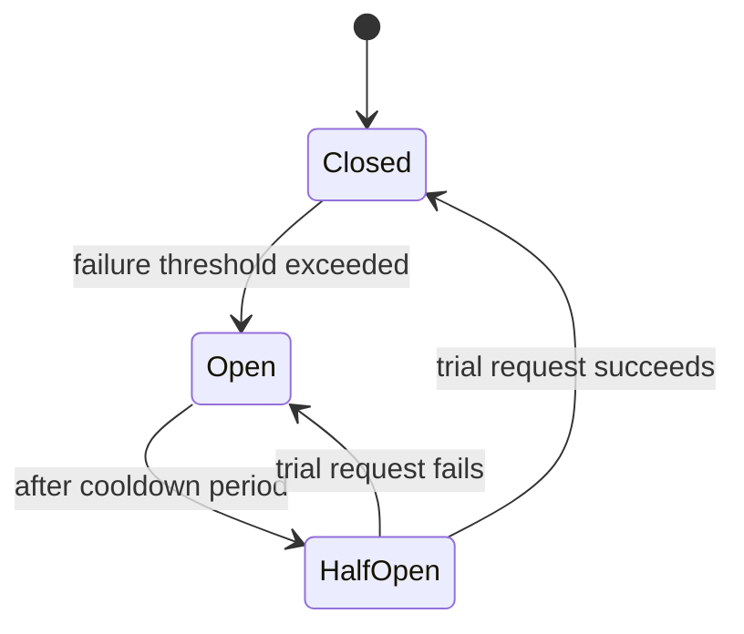
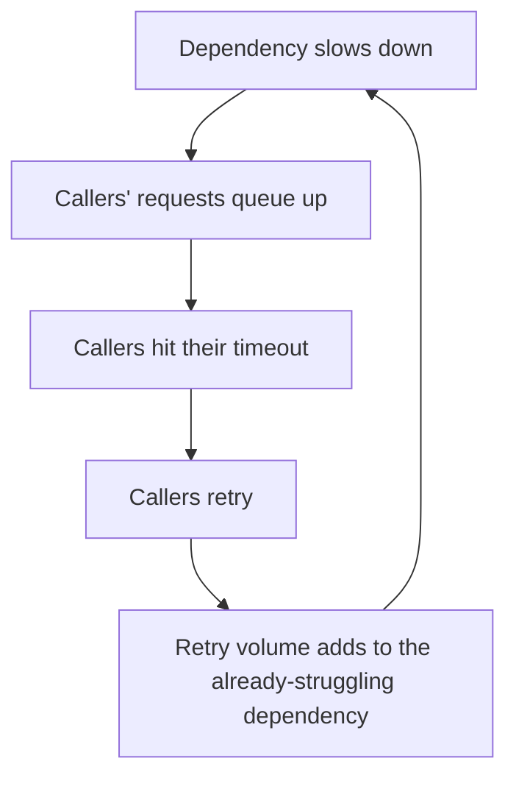

# Resilience

## 1. What is Resilience?

As distinguished in
[Fundamentals §4](../fundamentals/index.md#4-core-quality-attributes),
**fault tolerance** masks a failure so callers don't notice it happened;
**resilience** is the broader set of patterns for detecting, containing,
and recovering from failure once it happens — including deciding when
*not* to keep trying, which fault tolerance alone doesn't address.

## 2. Why It Exists

In a system with many dependencies (see
[Distributed Systems](../distributed-systems/index.md)), some dependency
is failing somewhere at any given moment, at real scale. Resilience
patterns exist so that one dependency's failure stays contained to the
functionality that actually needs it, instead of propagating outward and
taking down components that didn't fail themselves.

## 3. Timeout

Every network call needs an upper bound on how long to wait. Without one,
a hung downstream call ties up the caller's resources (threads,
connections) indefinitely — and under load, that resource exhaustion can
take the caller down even though the caller's own code never failed.

!!! danger "Common Trap"
    Setting no timeout, or a timeout so generous it's effectively none. A
    30-second timeout on a call that should take 50ms doesn't just mean
    the occasional slow response — it means a hung dependency can hold
    every one of the caller's request-handling threads hostage until each
    one individually times out.

## 4. Retry, Exponential Backoff & Jitter

Transient failures (a momentary network blip, a brief overload) often
succeed on retry. But retrying immediately, and every caller retrying at
the same time, makes the problem worse:

```text
Naive retry:
  Fail → retry immediately → fail again → retry immediately → ...
  (every failed caller hammers the struggling service at once)

Exponential backoff + jitter:
  Fail → wait ~1s (± random jitter) → retry
  Fail → wait ~2s (± random jitter) → retry
  Fail → wait ~4s (± random jitter) → retry
  (retries spread out over time instead of syncing into a wave)
```

**Jitter** — randomizing the wait slightly — matters specifically because
without it, many callers that failed at the same moment (e.g. due to one
bad deploy) all retry in lockstep, recreating the exact spike of load that
caused the failure in the first place.

## 5. Circuit Breaker

A circuit breaker stops calling a dependency once it's clearly failing,
instead of letting every request pay the cost of a slow failure:



| State | Behavior |
| ----- | ---------- |
| Closed | Requests pass through normally; failures are counted |
| Open | Requests fail immediately without calling the dependency at all |
| Half-Open | A limited trial request is allowed through to check if the dependency has recovered |

This protects both sides: the caller fails fast instead of waiting on a
known-bad dependency, and the struggling dependency gets relief from load
instead of being retried into the ground by every caller at once.

## 6. Bulkhead

Named after ship compartments that stop one breach from sinking the whole
vessel, a bulkhead isolates resources (thread pools, connection pools) per
dependency, so that one slow or failing dependency exhausting its own
pool doesn't starve requests to unrelated, healthy dependencies sharing
the same process.

## 7. Rate Limiting & Load Shedding

Rate limiting (see
[APIs & Communication §5](../apis-communication/index.md#5-rate-limiting-throttling))
protects a service from any single caller's excess — this page's concern
is closely related but different: **load shedding** protects the service
overall by deliberately rejecting some requests once it's approaching
capacity, regardless of which caller they're from, so it can keep serving
the requests it does accept rather than degrading for everyone.

## 8. Backpressure

Covered as a scaling concern in
[Scalability §11](../scalability/index.md#11-backpressure): signaling
upstream that a downstream component can't keep up, rather than accepting
unbounded work. It's the resilience-side counterpart to load shedding —
shedding drops excess at the door; backpressure tells the sender to slow
down before it arrives.

## 9. Graceful Degradation

Covered in
[Availability & Reliability §11](../availability-reliability/index.md#11-graceful-degradation):
serving a reduced but functional experience when a dependency fails,
rather than failing the whole request. It's the intended outcome that
circuit breakers and bulkheads make possible — isolating a failure is only
useful if there's a fallback behavior to isolate it *to*.

## 10. Hedged Requests

For latency-sensitive calls, a hedged request sends the same request to
multiple replicas (often staggered — e.g. send to a second replica only
if the first hasn't responded within the p99 latency) and uses whichever
response arrives first, canceling the rest. This trades extra load for
tail-latency reduction — worth it only when the extra requests are cheap
relative to the cost of a slow response.

## 11. Retry Storms & Cascading Failures

Resilience patterns can fail *together* in a way that makes things worse,
not better, if layered without coordination:



This is a **retry storm** — retries meant to help recovery instead prevent
it, because the extra load from retries lands on the same struggling
dependency. A **cascading failure** is the broader pattern: without
circuit breakers and bulkheads, one slow dependency's callers become slow
themselves, and their callers become slow in turn, propagating outward.

!!! warning "Production Reality"
    Retries, timeouts, and circuit breakers are not independent controls
    — a timeout with no circuit breaker just means callers keep paying
    the full timeout cost on every request to a service that's clearly
    down, and retries with no backoff turn a brief blip into the retry
    storm that keeps it down.

## 12. Common Mistakes

* No timeout, or a timeout long enough that resource exhaustion happens
  before it fires
* Retrying without backoff and jitter, synchronizing every caller's retry
  into a wave
* A circuit breaker with no fallback behavior behind it — failing fast is
  only half the value without graceful degradation to fail into
* Treating resilience patterns as independent add-ons instead of a
  coordinated set — see the retry-storm loop above

## 13. Related Concepts

* [Distributed Systems](../distributed-systems/index.md) — partial failure
  is why every one of these patterns is necessary in the first place
* [Availability & Reliability](../availability-reliability/index.md) — graceful
  degradation, which resilience patterns exist to make possible
* [Scalability](../scalability/index.md) — backpressure as the
  scaling-side counterpart to load shedding
* [Messaging & Events](../messaging-events/index.md) — dead-letter queues
  are the asynchronous equivalent of a circuit breaker's "stop trying"
