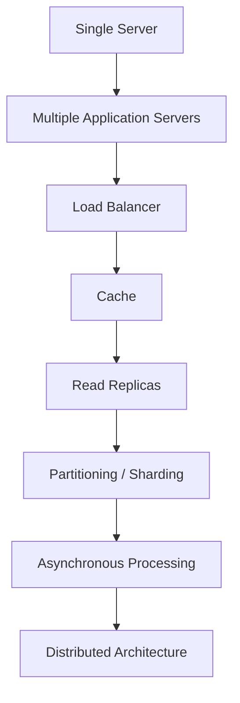
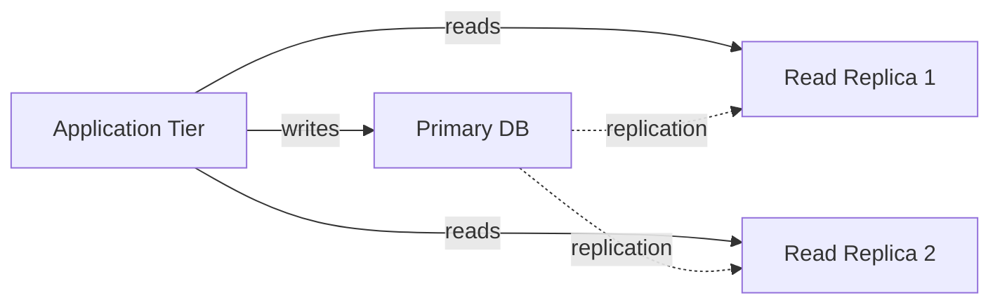
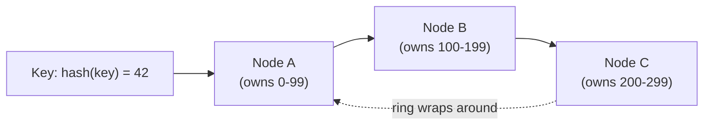

# Scalability

## 1. What is Scalability?

Scalability is a system's ability to handle growth in load — more users,
more data, more requests — by adding resources, rather than by the system
degrading or falling over. It is not the same as raw performance: a fast
single server that can't add capacity isn't scalable; a slower system that
adds capacity linearly with load is.

## 2. Why It Exists

Every system starts as a single server handling everything. That server
has a ceiling — CPU, memory, connections, disk I/O — and beyond it,
requests queue, latency climbs, and eventually requests fail. Scalability
is the set of techniques for moving that ceiling, or removing it entirely,
as the numbers from [Requirements & Estimation](../requirements-estimation/index.md)
demand.

## 3. The Scaling Evolution

Systems don't jump straight to a fully distributed architecture — each
step below is a response to the previous step's bottleneck becoming the
new limiting factor:

!!! tip "Quick Mental Model"
    Each arrow above exists because the previous stage's *specific*
    bottleneck was identified — not because "distributed is better." Adopt
    a stage when the numbers say you need it, not preemptively.

## 4. Scaling the Application Tier

Once one application server isn't enough, adding more only works if those
servers are stateless (see
[Fundamentals §7](../fundamentals/index.md#7-stateless-vs-stateful-systems)).
Session management is the usual sticking point:

| Approach | How it works | Trade-off |
| -------- | -------------- | ----------- |
| Sticky sessions | Load balancer routes a user to the same server every time | Simple, but breaks if that server fails; uneven load distribution |
| Shared session store | Sessions held in a shared cache (e.g. Redis) | Any instance can serve any request; adds a dependency |
| Stateless tokens (e.g. JWT) | Session data encoded in a signed token the client holds | No server-side session store at all; revocation is harder |

## 5. Scaling the Database: Read Replicas

Most systems are read-heavy (see
[Requirements & Estimation §9](../requirements-estimation/index.md#9-readwrite-ratio-and-why-it-matters)).
Read replicas copy data from a primary database to one or more replicas
that serve read traffic, leaving the primary to handle writes.

**Trade-off:** scales read capacity almost for free, but replication is
usually asynchronous — replicas can lag behind the primary, so a read
immediately after a write may return stale data unless the application
explicitly reads its own writes from the primary.

## 6. Scaling the Database: Partitioning & Sharding

Read replicas don't help write-heavy workloads, and eventually a single
primary's write capacity or storage becomes the ceiling. **Sharding**
splits data across multiple independent database instances, each holding a
subset of the data.

| Sharding Strategy | How it splits data | Weakness |
| ------------------ | --------------------- | ---------- |
| Range-based | By key range (e.g. user IDs 1-1M, 1M-2M) | Uneven load if some ranges are hotter |
| Hash-based | By hash of the key | Even distribution, but range queries become expensive |
| Directory-based | A lookup service maps keys to shards | Flexible, but the directory becomes a dependency |

!!! danger "Common Trap"
    Sharding before it's needed. Once data is sharded, cross-shard queries,
    joins, and transactions all become materially harder — this is a
    one-way door that should be justified by the estimation numbers, not
    adopted by default.

## 7. Consistent Hashing

Hash-based sharding has a problem: adding or removing a node with naive
`hash(key) % N` remaps almost every key, forcing a massive data reshuffle.
**Consistent hashing** solves this by placing both nodes and keys on a
hash ring — a key belongs to the next node clockwise from its hash
position, so adding or removing one node only remaps the keys between it
and its neighbor.

Real implementations assign each physical node many points on the ring
("virtual nodes") so load stays evenly distributed even with a small
number of nodes.

## 8. Caching and CDN for Scale

Caching and CDNs (see
[Core Building Blocks §11](../building-blocks/index.md#11-cache) and
[§6](../building-blocks/index.md#6-cdn)) are two of the highest-leverage
scaling techniques available, because they let the majority of requests
never reach the database or origin at all. See
[Caching](../caching/index.md) for strategies, eviction, and failure modes.

## 9. Asynchronous Processing & Queue-Based Scaling

Not every unit of work needs to finish before the client gets a response.
Moving non-blocking work onto a queue (see
[Core Building Blocks §13](../building-blocks/index.md#13-message-queues-event-streaming))
lets the application tier scale independently from the rate at which
background work is processed — the queue absorbs bursts, and consumers
scale to match the backlog rather than the request rate. See
[Messaging & Events](../messaging-events/index.md) for delivery guarantees
and failure handling.

## 10. Autoscaling

Autoscaling adds or removes capacity automatically based on a signal —
CPU utilization, queue depth, request rate. It only works for components
that are already horizontally scalable (stateless application tiers,
consumer groups) — autoscaling a stateful primary database isn't
meaningful in the same way.

!!! warning "Production Reality"
    Autoscaling reacts to load that's already happening. If new instances
    take two minutes to become healthy and traffic doubles in thirty
    seconds, users see the failure before the scaling response arrives —
    autoscaling reduces the need for static overprovisioning, it doesn't
    eliminate the need for headroom.

## 11. Backpressure

When a downstream component can't keep up, backpressure is the practice
of signaling that upstream — rejecting, delaying, or shedding requests —
rather than accepting unbounded work and failing catastrophically later
(e.g. an unbounded queue that eventually exhausts memory). This is scaling
in the other direction: protecting the system from load it can't yet
handle, until more capacity is available.

## 12. Common Mistakes

* Scaling the application tier when the database is the actual bottleneck
  — more app servers just send more load to an already-saturated database
* Sharding as a first move instead of exhausting simpler options (caching,
  read replicas, vertical scaling) first
* Assuming replication is synchronous and being surprised by stale reads
* Autoscaling without addressing cold-start time, so scaling always lags
  the traffic spike that triggered it

## 13. Related Concepts

* [Fundamentals](../fundamentals/index.md) — stateless design and
  horizontal vs vertical scaling, the prerequisites for most of this page
* [Requirements & Estimation](../requirements-estimation/index.md) — the
  numbers that justify each stage of the scaling evolution
* [Core Building Blocks](../building-blocks/index.md) — the components
  (load balancer, cache, queue) these techniques are built from
* [Availability & Reliability](../availability-reliability/index.md) — scaling
  for load and scaling for failure use overlapping techniques (replicas,
  redundancy) for different reasons
* [Data & Databases](../data-databases/index.md) and
  [Caching](../caching/index.md) — choosing what to shard/replicate, and
  what to cache, in more depth
* [Messaging & Events](../messaging-events/index.md) — the delivery
  guarantees behind the async processing in §9
