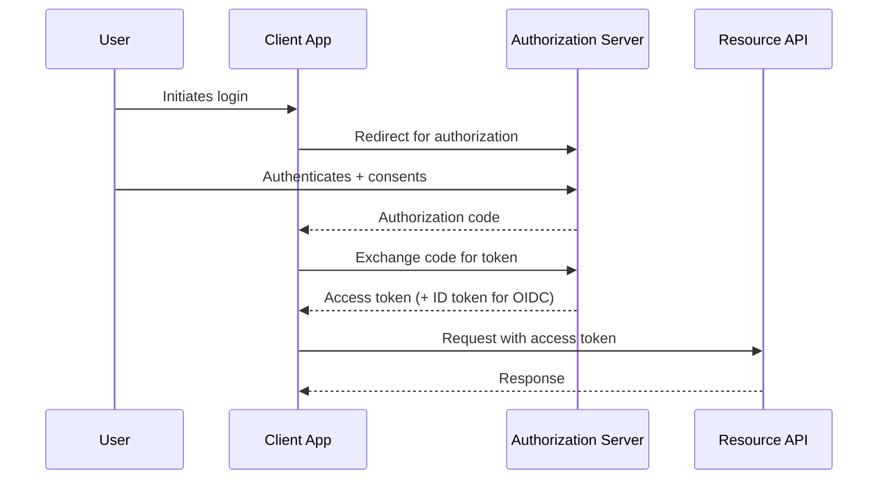
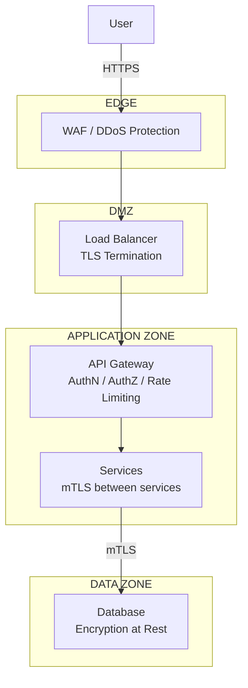

# Security

## 1. What is Security in System Design?

Security here is treated as an architectural concern — decisions about
trust boundaries, identity, and data protection that shape the diagram
itself — not a checklist applied after the design is done. This mirrors
how the [Architecture](../../architecture/index.md) track treats it: every
lab has its own `security.md` with controls shown on the actual component
diagram, not a separate appendix.

## 2. Why It's an Architectural Concern

A load balancer, an API gateway, and a database are all places where a
security decision changes the shape of the system — where TLS terminates,
which network zone a component sits in, what a compromised instance can
reach. Bolting security on after the architecture is fixed usually means
the architecture can't actually enforce the control being added.

## 3. Authentication vs Authorization

Two questions, easy to conflate:

| | Authentication (AuthN) | Authorization (AuthZ) |
| --- | --- | --- |
| Question answered | Who are you? | What are you allowed to do? |
| Typical mechanism | Password + MFA, OAuth/OIDC, mTLS | RBAC, ABAC, policy engines |
| Failure mode if skipped | Anyone can claim to be anyone | Any authenticated user can do anything |

## 4. OAuth 2.0 & OIDC

**OAuth 2.0** is an authorization framework — it lets a user grant a
third-party application limited access to their resources without sharing
their password. **OpenID Connect (OIDC)** is an identity layer built on
top of OAuth 2.0, adding authentication (proving who the user is, not just
granting access).

## 5. JWT

A **JSON Web Token** is a signed (optionally encrypted) token carrying
claims — who the user is, what they're allowed to do, when it expires —
that a server can verify without a database lookup.

!!! warning "Production Reality"
    JWTs are stateless by design, which is their appeal and their
    biggest operational problem: there's no server-side session to delete,
    so **revoking** a compromised token before its expiry requires extra
    machinery (a short expiry plus refresh tokens, or a denylist that
    reintroduces the state you were trying to avoid).

## 6. TLS & mTLS

* **TLS** encrypts traffic between a client and a server and lets the
  client verify the server's identity via its certificate.
* **mTLS (mutual TLS)** adds the reverse — the server also verifies the
  client's certificate — commonly used for service-to-service traffic
  inside a trust boundary where both sides need to prove identity, not
  just the server.

## 7. Secrets Management

Database passwords, API keys, and signing keys need to be available to
running services without being hardcoded in source, config files, or
container images — all of which end up in version control, logs, or
images shared more broadly than intended. A secrets manager stores them
centrally, injects them at runtime, and supports rotation without a
redeploy touching the secret's value directly.

## 8. Encryption at Rest & in Transit

| | Encryption in Transit | Encryption at Rest |
| --- | --- | --- |
| Protects against | Interception on the network | Access to the underlying storage/disk/backup |
| Typical mechanism | TLS/mTLS | Disk/volume encryption, database-level encryption |
| Doesn't protect against | A compromised endpoint that has already decrypted the data | An application-level vulnerability that legitimately reads the data |

Neither substitutes for the other — a system needs both, since they
protect against different points in the data's lifecycle.

## 9. Zero Trust & Network Segmentation

Traditional network security assumes anything inside the perimeter (e.g.
inside the corporate network) is trusted. **Zero trust** assumes no
implicit trust from network location alone — every request is
authenticated and authorized regardless of where it originates, including
service-to-service traffic inside the data center. **Network segmentation**
(placing tiers in separate zones, as in the
[Three-Tier LAMP security architecture](../../architecture/three-tier-lamp/security.md))
is a complementary, coarser-grained control: even without zero trust, a
compromised web server shouldn't be able to reach the database directly.

## 10. WAF & DDoS Protection

* A **Web Application Firewall (WAF)** inspects HTTP traffic for known
  attack patterns (SQL injection, XSS) before it reaches the application.
* **DDoS protection** absorbs or filters traffic floods intended to
  exhaust capacity rather than exploit a vulnerability — typically
  handled at the edge/CDN layer, before traffic reaches the origin at all.

## 11. RBAC & Least Privilege

**Role-Based Access Control (RBAC)** grants permissions to roles, and
roles to users, rather than managing permissions per user directly.
**Least privilege** is the principle it should be configured against:
every role should have the minimum access required to do its job, and
nothing more — so that a compromised account or service is limited in
what it can reach.

## 12. Audit Logging

A record of who did what, when — distinct from application logs, because
audit logs exist specifically to answer "what happened" during a security
review or incident, and are typically retained longer and protected from
tampering (e.g. write-once storage) for that reason.

## 13. Security on the Architecture Diagram

Security controls should be visible on the same diagram as the rest of the
architecture, not described only in prose — this is the same convention
used in the Architecture track's own security pages:

## 14. Common Mistakes

* Treating authentication and authorization as the same check — verifying
  identity but never checking whether that identity is allowed to perform
  the specific action requested
* Long-lived JWTs with no revocation path, so a leaked token stays valid
  for its full lifetime regardless of what's discovered
* Encrypting data at rest but not in transit between internal services,
  assuming the internal network is inherently trusted
* No audit logging on sensitive actions, discovered only when an incident
  requires reconstructing what happened and the record doesn't exist

## 15. Related Concepts

* [Architecture](../../architecture/index.md) — see these controls applied
  to specific, real platforms with recorded trade-offs (each lab has its
  own `security.md`)
* [APIs & Communication](../apis-communication/index.md) — rate limiting
  and idempotency, which double as abuse-prevention controls
* [Core Building Blocks](../building-blocks/index.md) — where the API
  gateway, load balancer, and other components security controls attach to
  sit in the request path
